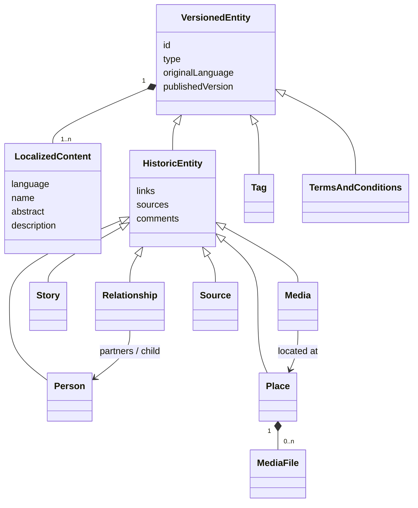

# Dorf-Archiv — Plan

> **Status:** design settled through a full review. Platform decisions, domain model and
> moderation workflow are agreed. Remaining open items are collected at the end and
> marked **(?)** — don't resolve one by implementing it.
>
> This supersedes the earlier all-Cloudflare draft. See **Platform** for why that changed.

---

## 1. What we're building

A website where local people upload photos and stories about the people and places of
their village, to preserve its history. Community-contributed, publicly readable,
**moderated before anything goes live**, and **used mostly from phones**.

The centrepiece is an **interactive map tied to a timeline**: tap a spot to see what has
been contributed there, or tap a spot to contribute. Around it sit the records
themselves — photos, stories, people, places — and later an ancestry view.

Four properties shape almost everything below:

- **Mobile-first, not mobile-adapted.** Contributors are standing in the village with a
  phone, or at the kitchen table photographing an album. Design the small screen first.
- **Contributors are not archivists.** Nobody knows the exact date of grandma's photo.
  Everything dated accepts "roughly" as an answer.
- **Nothing is published unmoderated.** Every contribution is a *proposal* until a
  moderator publishes it.
- **Everything assertable is citable.** A marriage, a photo's date, a place's location —
  each is a claim that can carry a source, a confidence and an argument in the comments.

First village: **Kammeltal**. Operator details (Impressum, contact) live in a config
file; current value `Archiv Kammeltal e.V.`. Seed corpus: the Freiwillige Feuerwehr
archive, digitised by the team before public launch — an empty map is a dead site.

---

## 2. Domain model — concepts

### 2.1 The entity hierarchy

Everything publishable descends from `VersionedEntity`, which owns versioning and the
propose/publish workflow. `HistoricEntity` adds the archival apparatus — links, sources,
comments — on top.



Stored as **table-per-type** with a discriminator on the entity table only. Loading a
Person is `entity ⋈ historic_entity ⋈ person_content`; three joins, real foreign keys,
no polymorphic columns.

**Why `Tag` and `TermsAndConditions` sit beside `HistoricEntity` rather than under it:**
a tag is vocabulary and the ToC is a legal document. Neither is an assertion about the
past, so neither needs sources or citations — but both need propose/publish and an edit
history, which is exactly what `VersionedEntity` provides.

**Why `Relationship` is an entity:** "Josef married Anna in 1893" is a claim, and claims
need a source, a fuzzy date, a confidence and somewhere to argue about them. A plain join
row can carry none of that. Unions and parentage are therefore first-class entities.

### 2.2 Versions and proposals

A **version** is a published state. It is created **at publish time**, never at proposal
time. Version numbers are per-entity integers, so `(entity_id, version)` is the natural
key and "Version 3" means something to a human.

A **proposal** is a suggested change. Content rows for proposals live in the *same tables*
as published content, distinguished by a nullable `proposal_id`:

| `proposal_id` | `version` | meaning |
| --- | --- | --- |
| `NULL` | `4` | published content of version 4 — written by a direct edit, or the merged result of proposals |
| set | `NULL` | pending proposal |
| set | `4` | proposal incorporated into version 4 |
| set | `NULL` + rejected status | rejected proposal, retained with its reason |

All four combinations are accounted for. Note that the published row-set is always
`proposal_id = NULL` whatever its origin — merging three proposals produces a fresh
published row-set, and the three proposals keep their own rows annotated with the version
they fed into. That is what keeps `WHERE proposal_id IS NULL` a complete read rule.
**A direct edit is simply a version with no proposals pointing at it** — derivable, so no
extra column; `entity_version` already records who published it and when.

Consequences:

- **Proposals are never publicly viewable**, enforced by `WHERE proposal_id IS NULL`
  rather than by remembering to check a state enum.
- **Provenance is free.** Version 4 consists of one published row-set plus however many
  incorporated proposal row-sets point at it, so "which proposals produced version 4" is
  a query.
- Proposals are **never deleted** — rejected ones persist with a reason and a moderator.
- A proposer sees their own pending proposal, marked as such.
- **A query that forgets `proposal_id IS NULL` silently returns version 4 several times
  over.** This is the one footgun in the model; it wants a default-scoped query helper,
  not discipline at each call site. Public reads get a partial index
  (`WHERE proposal_id IS NULL`).

### 2.2a Audit and mutability

**Every mutable row carries `created_at`, `created_by`, `updated_at`, `updated_by`** — not
just entities. That includes role grants and account approvals, so "who made this person a
moderator" and "who approved this account to see people-data" are answerable questions
rather than folklore. Version rows carry the quartet too, even though a version is
normally write-once: uniformity is worth more than saving two columns.

**Editing a proposal is normal and expected.** Contributors refine before review,
moderators adjust before merging. No ceremony, no warning.

**Editing a published version is exceptional, and the UI must say so.** It exists for one
purpose: legal redaction. Version history is a liability surface — if a photograph must
come down under a KUG or Urheberrecht claim, or personal data must be erased under DSGVO
Art. 17, publishing a corrected version does not help, because every prior version still
renders the offending content. Reaching into history is the only remedy.

So version edits are permitted, warned about loudly, always audited, and carry a **reason**
the way a rejection does. **Whether a redaction is visible in the public history (?)** —
"redacted on 2027-03-14" versus a silent change — is a per-redaction choice: transparency
is the archival default, but not every takedown benefits from being advertised.

Moderators can **combine several proposals into a single new version**. No branching —
a single coordinated moderation effort is assumed. The moderation UI needs a **diff view**
before publishing, and must flag a proposal whose `based_on_version` is no longer the
head, showing both diffs; otherwise publishing a stale proposal silently reverts whatever
landed in between.

### 2.3 The publish closure invariant

> **An entity cannot be published while any reference it holds points at something
> unpublished.**

One rule covering tags, entity links, places, sources — everything. Published content
references only published content (`proposal_id IS NULL`). The moderation UI lists a
proposal's unpublished dependencies with inline publish/remove and a "publish all" for
the common case of a photo proposed together with its new Place.

Stated once as a named invariant, because every new reference type would otherwise need
its own gate.

### 2.4 Localization

- Languages are **peers** for authoring: name, abstract, description and captions can be
  written in several.
- One language is flagged **original** on the entity. It is the source for
  auto-translation and the fallback for display.
- Non-translatable fields stay on the entity/subtype; **all language-dependent fields
  live in `LocalizedContent` sub-entities**, one per language.
- **A version snapshots all languages together.** A version is "the complete state of this
  record at time T", which is what you cite. A French typo fix bumps the version the
  German shares; the diff view makes it obvious what actually moved.
- Missing languages are **auto-translated at read**, cached persistently, keyed by
  `(entity, field, target language, hash of the original text)`. Hashing rather than
  version-counting means an edit to the original silently retires everything derived from
  it, with no bookkeeping.
- Machine output is **visibly labelled** ("Automatisch übersetzt") with the original one
  click away, and never enters the moderation queue as though a human wrote it. In an
  archive people cite, an unreviewed MT artefact becomes a "fact".
- A cache miss renders the available language immediately with a pending marker and fills
  in on the next load — never a blocking API call during a page render.

### 2.5 Fuzzy dates

Every dated thing carries `date_start`, `date_end` and a **precision enum**
(`day` / `month` / `year` / `decade` / `range` / `unknown`). One shape covers "1928",
"um 1930", "1920–1935" and "no idea"; it renders as German prose; and the timeline filter
becomes an indexable **overlap** query rather than an equality test. The upload UI offers
decade buttons, not a date picker.

### 2.6 Links vs. sources

Two parallel, deliberately separate mechanisms, both rendered at the foot of an entry:

- **Links** — inline references to other entities in this archive, authored as chips and
  aggregated into a *Links* section. Extracted at save time into a normalized table, which
  gives **backlinks for free**: a person's page lists every photo and story mentioning
  them, with nobody tagging anything by hand. This is most of the value — it's how a name
  on a 1952 Feuerwehr photo connects to a house, a family and three other photos.
- **Sources** — Wikipedia-style citations to external evidence (church book, civil
  register, Chronik page, interview, Wikipedia), with a locator, aggregated into a
  *Quellen* section.

People and places are **always referenced as links**, never as inline prose names, so the
entity owns its own naming and translations.

### 2.7 Places, media and geometry

- A **Place** is a point **or an area** (GeoJSON), plus derived min/max lat/lng columns
  for the indexed viewport query. Areas matter: a pin can sit at a position *within* an
  area. Places carry validity periods — house numbers get reused and renumbered, which is
  exactly what a map tied to a timeline exists to show.
- **Media may carry ad-hoc coordinates** when no Place exists ("the field behind the
  mill"), with the moderation queue offering "promote to a Place". The viewport query
  unions both sources. The alternative — forcing every contributor to invent a Place —
  blocks uploads on a taxonomy they don't have.
- A **Media entity is one artifact with 1..n files**, one primary. The back of a
  photograph with a handwritten date is the same artifact, not a separate record; forty
  photos from one album are forty records, because each is independently datable,
  placeable and citable.
- Binary **assets are immutable**; a version references assets, so adding or cropping a
  file produces a new version without mutating stored bytes. Originals are never
  overwritten.

### 2.8 Comments

Comments use propose/publish but are **not versioned** — a comment is an utterance, not a
revision. Each records the entity version it was written against, so the UI can flag
"this comment refers to an earlier version", which in an archive where facts get corrected
is genuinely useful. A comment never bumps the entity's version. No editing: delete and
repost.

---

## 3. Project structure

Bun workspaces + Turbo, as today. Responsibilities:

| Workspace | Owns |
| --- | --- |
| `shared/` | Cross-boundary types; the **directive-Markdown parser/serializer** (needed server-side to extract links, client-side to drive the editor); fuzzy-date formatting; permission definitions |
| `server/` | Hono API, domain layer, Drizzle schema + migrations, auth, moderation, search, translation, image derivatives, S3 access |
| `client/` | Vite + React 19 SPA — TanStack Router/Query, Tailwind v4, shadcn/ui, MapLibre, TipTap |
| `docker/` | Compose stack, custom Postgres image, MinIO |

The `shared` package matters more than in the bhvr template: the content format is parsed
on both sides, and a divergence between the two parsers corrupts stored content.

**Rule:** every write goes through the server's domain layer, never raw SQL — versioning,
the closure invariant and link extraction are all enforced there.

---

## 4. Platform

### 4.1 Runtime

| Concern | Choice |
| --- | --- |
| API | **Containerized Hono** (Node or Bun in Docker) — the only thing we package |
| Database | **Postgres**, reached by connection string; hosting unspecified |
| Object storage | **S3-compatible API**, reached by connection string; provider unspecified |
| ORM | **Drizzle** |
| Auth | **better-auth**, magic link |
| Local dev | Client and server run **from source on the host**; Compose supplies backing services |
| Config | All connection parameters as **environment variables** |

**Host is deliberately deferred**, and the code must keep it that way. Three deployment
shapes all have to work from the same source and the same configuration mechanism:

1. **Development** — client and server run from source on the host with hot reload, while
   Compose provides Postgres and MinIO. No containerized app in the loop; waiting on an
   image rebuild to see a change is not a dev experience anyone should accept.
2. **Compose as production** — the whole stack containerized on one box, self-contained.
   A perfectly legitimate deployment, not merely a development convenience.
3. **App container + external services** — the image deployed to a platform, with Postgres
   and object storage supplied by whoever runs them.

What makes one codebase serve all three is that the database and object store are always
**opaque endpoints behind connection strings**. Assume nothing about who operates them,
whether we hold superuser rights, which extensions are installed, or whether there is
filesystem access — and let no provider SDK leak into the code. In development those
strings happen to point at localhost; nothing else changes.

**Two separate Compose files, no profiles.**

- `docker/compose.dev.yml` — Postgres, MinIO, bucket initialisation. Standalone and
  self-sufficient; this is what development runs.
- `docker/compose.yml` — the full stack. Pulls the dependencies in with Compose's
  `include:` rather than restating them, so the two files can't drift. (If the installed
  Compose predates `include:`, the equivalent is `-f compose.dev.yml -f compose.app.yml`.)

Wrapped in root scripts so nobody types paths:

| Script | Does |
| --- | --- |
| `dev:deps` | dependencies only, **foreground**, tearing them down on exit |
| `dev:deps:up` / `dev:deps:down` | the same dependencies, detached, for when you want them out of the way |
| `stack:up` / `stack:down` | full stack, shape 2 |
| `dev` | unchanged — client and server from source, pointed at localhost |

`dev:deps` runs in the foreground and cleans up when you stop it, so there is no separate
teardown script to forget. Plain `docker compose up` stops containers on Ctrl+C but leaves
them lying around, and chaining `; docker compose down` doesn't survive an interrupt on
Windows — so this wants a small **Bun wrapper script** that spawns Compose in the
foreground and runs `down` from a signal handler. Bun rather than shell because it behaves
the same on Windows and Linux.

Important: teardown is `down` **without `-v`**. Volumes are named and survive, so stopping
the dev stack must never wipe the local database.

Two details that otherwise cost an afternoon each: the Compose stack needs a **one-shot
bucket-creation service** (`mc`) or first-run dev requires clicking through the MinIO
console, and the **dev Postgres image should carry the Hunspell dictionary** so local
search behaves like a good production rather than silently better or worse. Migrations run
from the host via Drizzle, not from inside a container.

The eventual host must be EU-hosted, containerizable and have a hard spending cap. That
decision can be made later without touching application code.

### 4.2 Why not Cloudflare Workers

The earlier plan targeted Workers + D1 + R2. Four independent requirements killed it:

1. **No hard spend cap.** Cloudflare's billing docs: *"Budget alerts are informational
   only. They do not pause or cap usage."*
2. **10ms CPU per request on the free tier**, against Cloudflare's own statement that
   workloads handling authentication typically use 10–20ms. Gated people-data makes that
   an authenticated *read* path.
3. **Not containerizable**, which the deployment requirement demands.
4. **Edge-distributed compute** sits awkwardly against a strict EU-processing requirement
   even with R2 and D1 pinned to the EU.

Moving to a container also *removed* three constraints the old plan was built around: the
10ms budget, the no-Node-builtins rule, and D1's `batch()`-only transactions — which the
three-level table-per-type model would have made genuinely painful.

### 4.3 German full-text search

Postgres ships a `german` configuration, but Snowball does **stemming only, not compound
splitting** — a search for *Kirche* will not match *Dorfkirche*. On a German corpus that
is most searches. The fix is a Hunspell `de_DE` dictionary layered ahead of the Snowball
stemmer, which requires write access to `$SHAREDIR/tsearch_data/` — available on a
database we administer, unavailable on most managed offerings.

Since the database is an opaque endpoint (§4.1), this is **a quality setting, not a hard
dependency**: the text-search configuration name is configuration, so the app runs against
a stock Postgres with reduced recall and against a Hunspell-equipped one at full quality.
Never hard-code the configuration name. Search quality is then one input to the eventual
host decision rather than a constraint on the code.

Multilingual indexing uses a per-row `regconfig` column plus a generated `tsvector`
column with one GIN index; queries must pass the matching config explicitly or the index
is not used. Historic name variants must be indexed too, or searching the spelling that
appears in the church book finds nothing.

### 4.4 Authorization

Permissions are **entity type × action** — `person:view`, `media:propose`,
`place:publish` — as a small in-house module (~50 lines), no library. Two flags on an
account, independently:

- `emailVerified` — automatic, gates contributing.
- `approved` — a manual moderator action, gates seeing people-data. Email verification
  proves someone owns an inbox, which is no barrier to a scraper, and the gated material
  is exactly the KUG-sensitive content.

better-auth's access-control plugin handles **platform roles** (admin/moderator/member)
only; it is purely role-based and cannot express conditions. **Role grants and account
approvals are audited like everything else** (§2.2a) — a moderator appearing without a
record of who appointed them is a governance hole, and "who approved this account for
people-data" is a question the KUG posture depends on being able to answer. Ownership
filtering — "a proposer sees their own pending proposals" — lives in the **query layer**
(`WHERE proposal_id IS NULL OR created_by = :me`), not in a permission engine. Keep the
permission module as a seam so conditions can arrive later if they're ever needed.

**Gating is enforced by the endpoint, not by redaction.** Preview and full content are
**separate endpoints** with separate permissions: the preview endpoint serves the preview
projection and is public and cacheable; the full endpoint requires `<entity>:view` and
returns **403** when the caller lacks it.

No endpoint returns a different shape depending on who is asking. That is worth stating as
a rule, because the alternative — one endpoint redacting fields per caller — is exactly
where field-leak bugs live, and it would turn every RPC response type into a union the
client has to narrow.

**Every request resolves an effective permission set, anonymous ones included:** the union
of the **public roles** and whatever roles the caller holds. There is therefore no
auth-free path and no special "public endpoint" concept — `<entity>:preview` is a
permission like any other, which merely *happens* to be granted to the public role by
default. What an anonymous visitor may see is an operational decision, not a constant in
the code.

Because public roles are configurable they belong in the database alongside the other
roles, not in a config file, and changes to them are audited (§2.2a). "Who made
people-data visible to the public" is a question this site must be able to answer.

Three tables, keeping roles and permissions distinct:

- **`role`** — the roles themselves.
- **`role_permission`** — role → permission, where **`role_id IS NULL` marks a public
  permission** held by everyone, no role required.
- **`user_role`** — user → role. Both columns non-nullable.

Effective permissions for a caller are still one query: the public rows, plus the
permissions of every role they currently hold.

```sql
SELECT permission FROM role_permission
WHERE revoked_at IS NULL
  AND (role_id IS NULL
       OR role_id IN (SELECT role_id FROM user_role
                      WHERE user_id = :me AND revoked_at IS NULL))
```

**All of them use validity intervals, not deltas and not version numbers.** Rows carry
`granted_at` / `granted_by` and nullable `revoked_at` / `revoked_by`; active means
`revoked_at IS NULL`. This keeps the hot lookup a single indexed query with no event
replay, touches only the row that actually changed rather than duplicating everything else
held by that user or role, and keeps the history *in* the table instead of in a parallel
audit log that can drift from it. Re-granting after a revocation is simply a new row.
"Who held moderator on 2027-03-14" is
`granted_at <= t AND (revoked_at IS NULL OR revoked_at > t)`.

Because `role_permission` is temporal too, **both halves of an authorization decision are
reconstructable at a point in time** — "what could this account do on that date" is a join
of the two tables filtered at the same instant. For a site whose KUG posture rests on who
was permitted to see what, that is the difference between an audit trail and a plausible
story.

Two implementation notes: uniqueness must be **partial** on both tables
(`WHERE revoked_at IS NULL`), since retaining revoked rows breaks a plain unique constraint
on re-grant; and the domain service exposes **separate functions for public and role-bound
permissions** rather than one function with a nullable argument.

The one hazard left is that `role_id IS NULL` **fails open**: forgetting the union
under-grants and is safe, but an accidental `NULL` *grants a permission to the entire
internet*. Splitting the tables this way already removes the worst version of it — there
is no nullable identity column on `user_role`, so a controller can no longer turn a
logged-out `session?.user?.id` into a universal grant. What remains is an administrative
path where the role is chosen deliberately, so keep public-permission grants as their own
explicit service method and never let a nullable role id arrive from request input.

**No HTTP caching for now** — responses send `Cache-Control: no-store`. Caching anonymous
responses by URL is a genuine optimisation later, but it carries an invalidation
obligation: tightening a public role while stale, more generous responses are still being
served is a privacy regression that looks exactly like everything working. Not worth
carrying before there is traffic to justify it.

Route permissions are **declared per route and fail closed** — a route that declares none
is rejected at startup rather than served unguarded. Forgetting the check on a new
endpoint is the realistic failure mode, so make it impossible rather than discouraged.

The client receives the caller's permission set with the session, so the UI decides what
to render without a round-trip per element. That is UX, not security: the server still
403s regardless of what the client believes.

### 4.5 Images

Client-side for the upload path — it saves bandwidth on village 3G and the crop/deskew UI
needs the bitmap anyway. Server-side is available again for derivative regeneration,
format migration and batch work.

The mobile constraint that must be designed around: **iOS caps total canvas area at
4096×4096 (16.7M px)**, so a 48MP iPhone photo fails — and `getContext('2d')` returns
`null` rather than throwing. There is also a ~384MB total canvas-memory ceiling that
Safari frees lazily. Therefore:

- Decode via an `` element (not canvas-capped) and `drawImage` **scaled down** into a
  canvas clamped to ~3000px on the long edge. Never allocate at source resolution.
- Reuse one canvas rather than chaining source → intermediate → destination; release by
  shrinking to 1×1.
- The **untouched original uploads directly to storage, never touching a canvas.**
- EXIF orientation is applied on decode — read EXIF for date/GPS on a separate path and
  never re-apply rotation, or you ship sideways photos.
- **Strip EXIF server-side on ingest.** A contributor photographing a print at home embeds
  their house's GPS coordinates. "The browser was supposed to strip it" is not a control —
  a bulk path or a client bug bypasses it silently.
- **The bucket is private.** Files reach the browser only through short-lived presigned
  URLs the backend issues after a permission check. Unpublished blobs sit in storage from
  the moment of upload, so a public bucket policy or a guessable key would bypass
  moderation entirely (§4.6 #3).

Auto edge detection (the scanner-app feel) is a **nice-to-have**, deferred: OpenCV.js is a
multi-megabyte WASM payload, a poor trade on mobile data. Manual four-corner crop first.

---

### 4.6 Fail-open inventory

Most mistakes in this design fail *closed* — a forgotten join under-grants, a missing role
denies. These are the ones that fail **open**, where an omission or a default produces more
access or more publication. Each needs a structural guard, not vigilance.

| # | Hazard | Guard |
| --- | --- | --- |
| 1 | **Forgetting `proposal_id IS NULL`** returns proposals alongside published rows — publishing unmoderated content, the one thing the design forbids | Base tables are read *only* inside the repository; the row→domain mapper **asserts** `proposal_id` is null and throws otherwise. Backed by a registry-driven conformance test (see #5): for every registered entity type, seed a proposal and assert every read path excludes it — so new entity types are covered without anyone remembering |
| 2 | **Preview DTOs built by omission** (`{...entity, description: undefined}`) leak every field added later | Build by explicit `pick`. A new field is invisible until deliberately exposed |
| 3 | **Unpublished blobs are in storage** before any moderator sees them; a public bucket or guessable key bypasses moderation entirely via direct URL | Private bucket, unguessable keys, and access only via **short-lived presigned URLs** issued by the backend after a permission check. Note a presigned URL is a bearer token for its lifetime — keep the TTL short, never log or embed them, and accept that redaction cannot recall one already issued |
| 4 | **Rendering a chip from its stored Markdown label** would show a redacted person's name wherever it was referenced | Chips always render from the **linked entity**, never the stored label, so they reflect current state. The label text still exists in the stored Markdown, so redacting a *name* means editing the prose of prior versions — the exceptional path in §2.2a |
| 5 | **The closure invariant as a hand-written loop** silently permits publishing once a fourth reference type exists | Iterate an **entity/reference registry**, so new types are covered by default. The same registry drives the conformance test in #1 — one structure, two guards |
| 6 | **Column defaults**: a truthy `approved`, or a create path setting `published_version` eagerly | `approved NOT NULL DEFAULT false`; entities created with `published_version` null |
| 7 | **Derived read paths** — backlinks, FTS, translation cache — are separate queries. Built on the base tables they'd expose proposals, superseded versions and gated text | Built on the views through **permission query handlers**, they inherit correctness by construction. Residual: permission-correct queries can still *compose* into a disclosure — published prose containing a chip that names a gated person — but that is a moderation judgement, not a query defect |
| 8 | **`role_permission.role_id IS NULL`** grants to the entire internet (§4.4) | Public grants are their own service method; a nullable role id never arrives from request input |
| 9 | **Permission resolution erroring** should never be read as "no restrictions" | Deny on error, explicitly |
| 10 | **`Cache-Control: no-store` flipping to a permissive default** when caching is added later | Caching stays opt-in per route; the default remains `no-store` |

## 5. Backend implementation

### 5.1 Layering

**Controller → Service → Repository**, with the Drizzle schema underneath. This fits the
stack well, because there genuinely is a domain layer here — versioning, the closure
invariant, moderation transitions and link extraction are rules, not CRUD.

- **Controller** — Hono handlers. HTTP only: validate input (zod), resolve the session,
  map domain objects to **DTOs**, set status codes. Knows nothing about versioning rules.
- **Service** — the domain. Versions and proposals, the publish closure invariant, link
  extraction, moderation transitions, translation orchestration. **Framework-free**: no
  Hono types, no `Request`/`Response`. This is what lets background jobs and any future
  import path reuse the rules instead of reimplementing them.
- **Repository / model** — Drizzle queries and the mapping from rows to domain objects.
  The only place base tables are touched. Drizzle's inferred row types stop at this
  boundary and must not leak into services or DTOs.
- **Permission query handlers** — the layer that turns an effective permission set into
  query constraints, so every read path (including FTS, backlinks and translation lookups)
  is permission-correct by construction rather than by each author remembering.

**Mapping rather than read/write separation.** Published-content views (`published_media`
et al.) were considered and rejected: they double the schema surface — a column added to a
table is silently invisible until added to the view — and read paths here are the
join-heavy ones where Drizzle's relational query builder earns its keep, which views may
not participate in. Separating read and write models is a large commitment for a
two-person project, and the type-level benefit was really the mapper's, not the view's.

Instead, **the mapper asserts**: `toPublished(row)` throws when `row.proposal_id` is not
null. That matters because a mapper alone would *hide* proposal-ness rather than catch it,
turning a leak into a silently well-typed one.

Two caveats specific to this stack:

1. **Hono RPC types come from a single chained expression.** Splitting controllers across
   files is fine, but each controller must itself be one chained
   `new Hono().get(...).post(...)`, and the root must mount them in one chained expression
   via `.route("/media", mediaController)`. Assigning routes as separate statements
   silently erases them from the client's types — the warning already in `AGENTS.md`, now
   applying per controller.
2. **Authorization lives in the controllers**, as route-level checks — see §4.4. Services
   stay free of permission logic; they are called by background jobs that act as the
   system, not as a user. The safeguard that makes this safe is a **fail-closed route
   declaration**: every route names the permission it requires, and a route declaring none
   is rejected at startup rather than served unguarded.

DTO placement: response shapes reach the client through Hono RPC inference and need no
duplication; request shapes the client must *construct* belong in `shared`.

### 5.2 Tables

**Every table below carries the audit quartet** — `created_at`, `created_by`,
`updated_at`, `updated_by` — including join tables, role grants and approvals. Omitted
from the per-table notes to avoid repeating it fourteen times.

**Identity and versioning**

| Table | Notes |
| --- | --- |
| `entity` | `id`, `type` (discriminator), `original_language`, `published_version` |
| `entity_version` | `(entity_id, version)`, `published_at`, `published_by`, `redaction_reason` |
| `proposal` | `id`, `entity_id`, `kind` (create/edit), `status`, `rejection_reason`, `moderator_id`, `based_on_version`, `terms_version` |

Type is **not** duplicated onto `proposal` — it's one join to `entity`.

**Content** — every row carries `entity_id`, nullable `version`, nullable `proposal_id`:

| Table | Notes |
| --- | --- |
| `localized_content` | `language`, `name`, `abstract`, `description`, generated `tsvector`, `regconfig` |
| `person_content` | birth/death fuzzy dates, non-translatable attributes |
| `place_content` | point lat/lng, GeoJSON area, derived bbox, validity period |
| `media_content` | capture fuzzy date, optional ad-hoc lat/lng |
| `story_content` | — |
| `relationship_content` | kind, partner/child entity references, fuzzy date |
| `source_content` | citation metadata |
| `content_tag` | → tag entity |
| `content_link` | → target entity (from directive extraction) |
| `content_source` | → source entity + locator (page, date, timestamp) |
| `media_file` | → `asset`, role (original/web/thumb), primary flag, sort |

**Immutable and auxiliary**

| Table | Notes |
| --- | --- |
| `asset` | storage key, sha256, mime, bytes, dimensions — never mutated |
| `comment` | entity, author, body, moderation status, `made_on_version` |
| `translation_cache` | entity, field, target language, source hash, text, provider |
| `role` | the roles themselves |
| `role_permission` | role → permission; **`role_id IS NULL` means a public permission**. Temporal: `granted_at/by`, nullable `revoked_at/by`; active = `revoked_at IS NULL` |
| `user_role` | user → role, both non-nullable, same temporal shape |
| `terms_acceptance` | user, ToC entity + version, accepted at |
| `notification_outbox` | queued emails |
| better-auth tables | via the Drizzle adapter |

### 5.3 Indexes that matter

- Partial index `WHERE proposal_id IS NULL` behind every public read path.
- Partial indexes `WHERE revoked_at IS NULL` on `user_role (user_id)` and
  `role_permission (role_id)`, plus partial **unique** indexes on `(user_id, role_id)` and
  `(role_id, permission)` under the same predicate — a plain unique constraint would block
  re-granting something previously revoked.
- GIN over the generated `tsvector` in `localized_content`.
- btree on `place_content` bbox columns and `media_content` lat/lng for the viewport query.
- btree on `(entity_id, version)` everywhere content rows are keyed.

### 5.4 Routes, roughly

Public read (no auth, cacheable) · gated read (approved sessions) · propose · moderate
(queue, diff, publish, reject, dependency resolution) · upload (direct-to-storage +
metadata) · search · translate · notification dispatch.

Every route declares the permission it requires; anonymous callers resolve to the public
role set (§4.4). Nothing is HTTP-cached for now — `Cache-Control: no-store` throughout.

---

## 6. Frontend implementation

Vite + React 19, TanStack Router (file-based) + TanStack Query, Tailwind v4, shadcn/ui.
**Paraglide JS** for UI strings — TanStack Router documents it as the primary i18n
integration, and its `rewrite` option handles locale-prefixed URLs while file routes stay
canonical. It tree-shakes per message, which matters when contributors are on 3G.

### Components

**Map and timeline**
- `MapView` — MapLibre GL JS. Pins, GeoJSON areas, viewport-driven loading. Raster
  overlays for historic maps with an opacity slider. `CooperativeGesturesHandler` so a
  full-width map doesn't trap page scroll on mobile.
- `TimelineControl` — filters the map by an **overlap** test against fuzzy date ranges;
  also selects which historic overlay is offered.
- `PlacePin`, `PlaceArea`, `MapUploadAffordance` — tap a location to contribute there.

**Entities**
- `EntityPreview` — name, abstract, sample images. The public projection.
- `Permission` — renders its children when the caller holds the named permission, and a
  **fallback** otherwise (blur plus a login or request-access prompt by default). The
  fallback slot can be given explicitly, and the natural thing to put there is the
  *preview* — so a gated record degrades to name, abstract and sample images rather than
  vanishing. Purely a rendering decision; the server enforces independently.
- `EntityChip` — an inline link, resolved against the *current* target so corrections
  propagate; falls back to the label stored in the directive when a target is gone.
- `LinksSection` / `SourcesSection` — the two aggregation blocks at the foot of an entry.
- `FuzzyDate` — renders "um 1930" per locale.
- `VersionHistory` — browse and render prior versions (rendered, never queried).
- `CommentThread` — with the "refers to an earlier version" marker.

**Editing and upload**
- `RichTextEditor` — **TipTap** with a custom inline mention node, serializing to
  **directive-Markdown** for storage. The bidirectional serializer is real work, not
  configuration.
- `EntityMentionPicker` — the "@" autocomplete that inserts a chip.
- `CameraCapture` — `<input type="file" accept="image/*" capture="environment">`. Note
  `capture` is a *hint*: users can still pick from the library and desktop ignores it, so
  offer both a camera and a file input rather than relying on UA behaviour.
- `CornerCropper` — manual four-corner perspective correction, clamped per §4.5.
- `BatchUploadForm` — multi-file select with **shared metadata** (place, rough date, tags
  set once) then per-item correction. Without this, digitising 300 Feuerwehr photos one at
  a time is where the seed corpus quietly dies. Same components as the phone flow, denser
  layout.
- `FuzzyDateInput` — decade buttons first, precise entry second.

**Moderation**
- `ModerationQueue` — grouped by type, batch actions.
- `ProposalDiff` — field-level diff; nothing for a `create` proposal.
- `DependencyList` — unpublished references blocking publication, with inline
  publish/remove and "publish all".
- `DanglingChipRepair` — fix references broken by a rejected or merged target.
- `StaleProposalWarning` — when `based_on_version` is behind the head.

**Search**
- `CommandPalette` (Cmd+K) over all published entities, plus per-type search on the
  person and place pages. **Cmd+K is a desktop idiom** — mobile needs a persistent search
  affordance in the nav.
- Search covers published content only. Surfacing superseded text means showing what the
  archive has explicitly corrected.

---

## 7. Legal and moderation

**Not legal advice — this needs review by a Rechtsanwalt before the first public upload**,
not after. A German site publishing photographs of identifiable people has real exposure.

- **Impressum** (DDG §5) and **Datenschutzerklärung** (DSGVO Art. 13) as real pages,
  populated from the operator config.
- **Every proposal requires a logged-in, verified real person.** No anonymous path — an
  email typed into a form is not a rights chain, and without one the liability stops at
  the Verein.
- At upload the contributor **certifies rights under the ToC**, recorded as a versioned,
  timestamped acceptance. This gives recourse against the uploader; it does not eliminate
  host liability once you are notified about a specific item. Pre-publication moderation
  remains the practical defence.
- **Urheberrecht**: *Lichtbildwerk* 70 years post mortem, simple *Lichtbild* 50 years from
  publication. Whoever holds the print is often not the rights holder.
- **KUG §22** — publishing identifiable people needs consent, protection extends 10 years
  past death. Long-dead villagers are unproblematic; a 1990s Feuerwehrfest group photo is
  not. §23's *Versammlungen* exception genuinely covers public events like Feste and
  parades. **This belongs in the moderator checklist**, not in individual judgement — the
  Feuerwehr seed corpus is largely 20th century, which makes it live rather than
  theoretical.
- A reachable **report/takedown route** on every published item.
- **Deletion (?)** — when an account is erased, do their contributions go too, or does the
  alias detach? An archive that silently loses contributions isn't much of an archive.

---

## 8. Sequence

1. **Groundwork** — Compose stack, custom Postgres image, MinIO, Drizzle, one persisted
   route end to end.
2. **Domain core** — entity hierarchy, versions, proposals, closure invariant, localized
   content, fuzzy dates. The hardest part, and everything else assumes it.
3. **Auth** — better-auth, magic link, `emailVerified` + `approved`, roles.
4. **Upload** — camera and file, crop/deskew, client derivatives, batch metadata.
5. **Moderation** — queue, diff, dependencies. *Nothing can go public before this exists.*
6. **Map + timeline** — pins, areas, viewport loading, time filter, upload-by-tap.
7. **Content editing** — TipTap, directive serializer, link extraction, backlinks.
8. **Search** — German FTS with Hunspell, command palette.
9. **Seed corpus** — digitise the Feuerwehr archive, publish, *then* open to the public.
10. **Historic overlays** — georeferencing (QGIS, offline), tiles in storage.
11. **Ancestry** — person detail, pedigree view, relationship entities.
12. **Later** — comments, notifications at scale, chronicle/timeline views, export.

4 and 5 are a pair. 9 gates public launch.

---

## 9. Open items

- **Host (?)** — deferred deliberately. Must be EU, containerizable, hard spend cap.
  Fixed-price VPS and Railway both qualify; Cloudflare, Fly.io, Scaleway and Neon do not.
- **Backups (?)** — owner and mechanism, once the host is chosen. Self-managed Postgres
  means this is ours. An archive that loses data has failed at its only job.
- **Translation provider (?)** — DeepL's paid API processes in the EEA, deletes after
  service and has a genuine hard cost cap. **Its free tier trains on submitted content**,
  which is a GDPR problem with named villagers' data. Alternatives: eTranslation (EU
  Commission, possibly free for an eligible archive), or self-hosting a model. Could also
  simply be deferred — store the language columns now, wire a provider later.
- **`Source` as a `HistoricEntity` subtype (?)** — modelled that way above, but this was
  inferred rather than decided. It may be a plain reusable table.
- **Historic name variants (?)** — deferred. Names currently live in free text or are
  themselves entities. Kammeltal/Kammelthal will force this eventually.
- **SEO and social previews (?)** — the client is a client-rendered SPA, so initial HTML
  is near-empty and links shared to WhatsApp or local Facebook groups get bare cards. For
  a site that spreads by exactly that kind of sharing this matters. Fixable with
  prerendering or edge-injected per-route meta.
- **Legal review (?)** — who, and when. Before the first public upload.
- **Ancestry detail** — pedigree layout (`d3-hierarchy`) is sketched; a general
  relationship graph is not. Living-person restriction rules need writing down.
- **Auto edge detection (?)** — deferred; OpenCV.js payload.
- **Verify before committing money** — current VPS and object-storage pricing, and whether
  DeepL's API Free tier still exists.

## 10. Deliberately not doing

SSR, real-time collaboration, DNA/matching, native mobile apps, a plugin system, branching
version histories, a general ABAC engine. None ruled out; none belong in v1.
