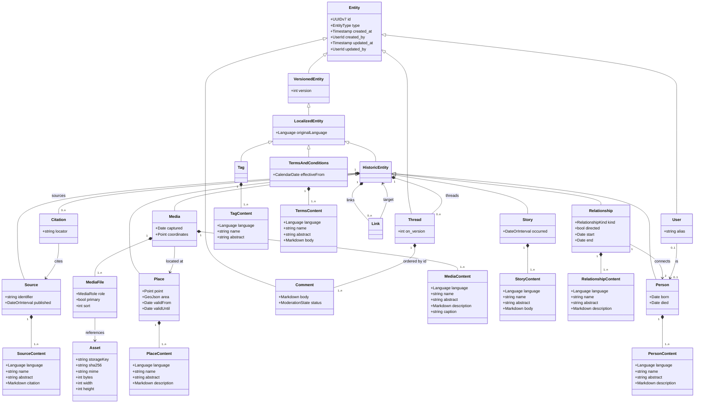

# Dorf-Archiv — Plan

> **Status:** design settled through a full review. Platform decisions, domain model and
> moderation workflow are agreed. Remaining open items are collected at the end and
> marked **(?)** — don't resolve one by implementing it.
>
> This supersedes the earlier all-Cloudflare draft. See **Platform** for why that changed.

---

## 1. What we're building

A website where local people upload photos and stories about the people and places of
their village, to preserve its history. Community-contributed, publicly readable,
**moderated before anything goes live**, and used from phones *and* desktops in roughly
equal measure — but for different things.

The centrepiece is an **interactive map tied to a timeline**: tap a spot to see what has
been contributed there, or tap a spot to contribute. Around it sit the records
themselves — photos, stories, people, places — and later an ancestry view.

Four properties shape almost everything below:

- **Contributing is phone-shaped; viewing is desktop-shaped.** Someone stands in the
  village with a phone, or sits at the kitchen table photographing an album — but the
  person browsing old photographs of their street, reading an entry with its sources, or
  working through a family tree is far more likely at a desk. Neither is the primary
  screen. Design each surface for where it is actually used, and support both properly:
  a desktop layout mechanically derived from a phone one wastes the screen on exactly the
  pages people linger on.
- **Contributors are not archivists.** Nobody knows the exact date of grandma's photo.
  Everything dated accepts "roughly" as an answer.
- **Nothing is published unmoderated.** Every contribution is a *proposal* until a
  moderator publishes it.
- **Everything assertable is citable.** A marriage, a photo's date, a place's location —
  each is a claim that can carry a source, a confidence and an argument in the comments.

First village: **Kammeltal**. Operator details (Impressum, contact) live in a config
file; current value `Archiv Kammeltal e.V.`. Seed corpus: the Freiwillige Feuerwehr
archive, digitised by the team before public launch — an empty map is a dead site.

---

## 2. Domain model — concepts

### 2.1 The entity hierarchy

Four layers, each adding exactly one capability:

- **`Entity`** — identity, the type discriminator, and the audit quartet
  (`created_at`/`created_by`/`updated_at`/`updated_by`) that §2.2a requires everywhere.
  `User`, `Thread` and `Comment` descend from it directly: each has identity and an audit
  trail, none has versions.
- **`VersionedEntity`** — versioning and the propose/publish workflow. Everything
  publishable descends from it.
- **`LocalizedEntity`** — an original language and per-language content rows.
- **`HistoricEntity`** — the archival apparatus: links, sources, comments.



**Every subtype is an `X` / `XContent` pair**: `X` holds what does not vary by language,
`XContent` holds what does, one row per language.

Only the *distinctive* content fields are drawn. Every `XContent` additionally carries
`language`, `name` and `abstract` by convention (§2.4) — and `description` wherever the
type has no more specific long-text field, which is why `StoryContent` and `TermsContent`
show `body` and `MediaContent` shows `caption` instead. `TagContent` is a label: `name`
only.

`MediaFile` is a per-version reference; `Asset` is the immutable stored blob. Adding or
re-cropping a file produces a new version pointing at different assets, never a mutation of
bytes already written (§2.7).

Stored as **table-per-type** with a discriminator on the entity table only. Loading a
Person is `entity ⋈ historic_entity ⋈ person`, plus `person_content` for the requested
language; real foreign keys, no polymorphic columns.

**Why `Tag` and `TermsAndConditions` sit beside `HistoricEntity` rather than under it:**
a tag is vocabulary and the ToC is a legal document. Neither is an assertion about the
past, so neither needs sources or citations — but both need propose/publish and an edit
history, which is exactly what `VersionedEntity` provides.

**Why `Relationship` is an entity:** "Josef married Anna in 1893" is a claim, and claims
need a source, a rough date, a confidence and somewhere to argue about them. A plain join
row can carry none of that. Unions and parentage are therefore first-class entities.

A `Relationship` connects **exactly two `Person`s** — it is what the ancestry graph is
drawn from, and nothing else belongs in that graph. `directed` distinguishes the two
shapes: `married` is commutative and reads the same from either end, `child` is not.
`start` and `end` are both optional rough dates, so a marriage can record when it began,
when it ended, either, or neither.

### 2.2 Versions and proposals

A **version** is a published state. It is created **at publish time**, never at proposal
time. Version numbers are per-entity integers, so `(entity_id, version)` is the natural
key and "Version 3" means something to a human.

A **proposal** is a suggested change. Content rows for proposals live in the *same tables*
as published content, distinguished by a nullable `proposal_id`:

| `proposal_id` | `version` | meaning |
| --- | --- | --- |
| `NULL` | `4` | published content of version 4 — written by a direct edit, or the merged result of proposals |
| set | `NULL` | pending proposal |
| set | `4` | proposal incorporated into version 4 |
| set | `NULL` + rejected status | rejected proposal, retained with its reason |

All four combinations are accounted for. Note that the published row-set is always
`proposal_id = NULL` whatever its origin — merging three proposals produces a fresh
published row-set, and the three proposals keep their own rows annotated with the version
they fed into. That is what keeps `WHERE proposal_id IS NULL` a complete read rule.
**A direct edit is simply a version with no proposals pointing at it** — derivable, so no
extra column; `entity_version` already records who published it and when.

Consequences:

- **Proposals are never publicly viewable**, enforced by `WHERE proposal_id IS NULL`
  rather than by remembering to check a state enum.
- **Provenance is free.** Version 4 consists of one published row-set plus however many
  incorporated proposal row-sets point at it, so "which proposals produced version 4" is
  a query.
- Proposals are **never deleted** — rejected ones persist with a reason and a moderator.
- A proposer sees their own pending proposal, marked as such.
- **A query that forgets `proposal_id IS NULL` returns proposals to the public** — that is,
  it publishes unmoderated content, and also duplicates version 4 once per incorporated
  proposal. The guards are in §4.6 #1: base tables are read only inside the repository, the
  row→domain mapper asserts, and a registry-driven conformance test proves it per entity
  type. Public reads get a partial index (`WHERE proposal_id IS NULL`).

### 2.2a Audit and mutability

**Every mutable row carries `created_at`, `created_by`, `updated_at`, `updated_by`** — not
just entities. That includes role grants and account approvals, so "who made this person a
moderator" and "who approved this account to see people-data" are answerable questions
rather than folklore. Version rows carry the quartet too, even though a version is
normally write-once: uniformity is worth more than saving two columns.

**Editing a proposal is normal and expected.** Contributors refine before review,
moderators adjust before merging. No ceremony, no warning.

**Editing a published version is exceptional, and the UI must say so.** It exists for one
purpose: legal redaction. Version history is a liability surface — if a photograph must
come down under a KUG or Urheberrecht claim, or personal data must be erased under DSGVO
Art. 17, publishing a corrected version does not help, because every prior version still
renders the offending content. Reaching into history is the only remedy.

So version edits are permitted, warned about loudly, always audited, and carry a **reason**
the way a rejection does. **Whether a redaction is visible in the public history (?)** —
"redacted on 2027-03-14" versus a silent change — is a per-redaction choice: transparency
is the archival default, but not every takedown benefits from being advertised.

Moderators can **combine several proposals into a single new version**. No branching —
a single coordinated moderation effort is assumed. The moderation UI needs a **diff view**
before publishing, and must flag a proposal whose `based_on_version` is no longer the
head, showing both diffs; otherwise publishing a stale proposal silently reverts whatever
landed in between.

### 2.3 The publish closure invariant

> **An entity cannot be published while any reference it holds points at something
> unpublished.**

One rule covering tags, entity links, places, sources — everything. Published content
references only published content (`proposal_id IS NULL`). The moderation UI lists a
proposal's unpublished dependencies with inline publish/remove and a "publish all" for
the common case of a photo proposed together with its new Place.

Stated once as a named invariant, because every new reference type would otherwise need
its own gate.

### 2.4 Localization

- Languages are **peers** for authoring: name, abstract, description and captions can be
  written in several.
- One language is flagged **original** on the `LocalizedEntity`. It is the source for
  auto-translation and the fallback for display.
- Non-translatable fields stay on the subtype; **all language-dependent fields live in a
  per-type content companion**, one row per language: `Place`/`PlaceContent`,
  `Person`/`PersonContent`, and so on.

  There is deliberately **no single shared `LocalizedContent`**. Types need genuinely
  different translatable fields — Media has a *caption*, Story a *body* rather than a
  description, Source its citation text, Tag only a *label* — and forcing all of them
  through one `name`/`abstract`/`description` row means columns that are always null for
  half the types and no home for the fields that don't fit.

  The cost is that the uniform parts of the system — the preview projection (§4.4), the
  detail page, search — need *some* fields to be present everywhere. That is handled by
  **convention rather than inheritance**: every `XContent` carries `name` and `abstract`,
  and the entity registry (§4.6 #5) enforces it in a test. A shared base table would give
  that structurally, but at the price of a fifth join on every read and empty rows for
  types that don't want the extra fields.
- **A version snapshots all languages together.** A version is "the complete state of this
  record at time T", which is what you cite. A French typo fix bumps the version the
  German shares; the diff view makes it obvious what actually moved.
- **A language, once published, cannot be removed by a proposal.** A proposal is a
  complete state (§11), so leaving a language out would read as deleting it; that is
  refused instead. Content that must go is a redaction (§2.2a), not an edit.
- Missing languages are **auto-translated at read**, cached persistently, keyed by
  `(entity, field, target language, hash of the original text)`. Hashing rather than
  version-counting means an edit to the original silently retires everything derived from
  it, with no bookkeeping.
- Translation is **one module with a provider adapter behind it** —
  `translate(entity, field, targetLanguage, actor)` handles cache lookup, source selection,
  directive protection, the provider call and labelling. The provider is a genuine seam
  rather than a hypothetical one: DeepL, eTranslation and a self-hosted model are all live
  candidates (§9), so something really does vary across it.
- Machine output is **visibly labelled** ("Automatisch übersetzt") with the original one
  click away, and never enters the moderation queue as though a human wrote it. In an
  archive people cite, an unreviewed MT artefact becomes a "fact".
- A cache miss renders the available language immediately with a pending marker and fills
  in on the next load — never a blocking API call during a page render.

### 2.5 Dates

**A date is an anchor plus a granularity**: `day`, `month`, `year` or `decade`. "Specific"
is not a separate kind — it is simply `day` granularity, so there is one concept rather
than two with a flag between them. Every rough date therefore *denotes a span*: `1920s` is
1920-01-01 … 1929-12-31, `März 1920` is that month, `14. März 1920` is that day.

**An interval is two rough dates**, each with its own granularity — so "from the 1920s
until March 1931" is expressible, which a single shared precision value cannot do. A single
date is an interval with no end. An unknown date is absent entirely.

That replaces the earlier single enum (`day`/`month`/`year`/`decade`/`range`/`unknown`),
which conflated three different things: granularity, whether there are one or two
endpoints, and whether a date exists at all. Only the first is a property of a date.

**Rough boundaries must not overlap.** "From the 1920s to 1925" is not a wide interval, it
is a contradiction: the start's span already contains the end. So the rule is that the
start's span must end at or before the end's span begins. Adjacent spans are fine (1920s →
1930s); a start and end resolving to the same span is rejected, because "1920 to 1920" is a
single rough date rather than an interval and should be stored as one.

#### Three embedded types

`RoughDate` is the primitive — a `daterange` plus a granularity, two columns. On top of it
sit three **embedded value types**. None is a table; each inlines its columns into whatever
row uses it, named by prefix.

| Type | Shape | Meaning |
| --- | --- | --- |
| **`Date`** | one `RoughDate`, required | a single point-or-span |
| **`DateOrInterval`** | start required, end optional | one set ⇒ a date; both set ⇒ an interval |
| **`Interval`** | both required | genuinely spans a period |

> **Naming, because "date" is overloaded.** Throughout this document and the codebase,
> **`Date` always means a `RoughDate`** — an anchor plus a granularity, denoting a span.
> An exact calendar date is **`CalendarDate`** (a plain SQL `date`), used only where the
> value is administrative rather than archival: the ToC's `effectiveFrom`. Audit columns
> are `timestamptz` and are neither.

Storage, using Postgres range types — available now that we're not on SQLite:

```sql
-- DateOrInterval, non-nullable
<field>_start              daterange        NOT NULL
<field>_start_granularity  date_granularity NOT NULL
<field>_end                daterange              -- NULL ⇒ a Date, not an Interval
<field>_end_granularity    date_granularity
<field>_extent             daterange GENERATED    -- hull, GiST-indexed for the timeline

CHECK (<field>_end IS NULL OR upper(<field>_start) <= lower(<field>_end))
```

`Date` drops the `_end` columns. `Interval` makes them `NOT NULL`.

**Nullable embedding.** When a `DateOrInterval` is optional, `_start` becomes nullable and
*both* columns null means the whole value is absent. An end without a start is not "an
open-ended interval", it is a corrupt row, so it needs its own constraint:

```sql
CHECK (<field>_start IS NOT NULL OR <field>_end IS NULL)
```

Without that, a partially-written row is indistinguishable from a deliberate one, and the
extent silently computes from a null start.

The constraint expresses ordering *and* non-overlap in one expression, and it is enforced
by the database rather than by whichever code path happens to write the row — which
matters, since these dates arrive from the upload form, the moderation UI and any future
import alike.

The generated `extent` is what the timeline filters on: a GiST-indexed `&&` overlap test
against the selected window, which is both cheaper and more honest than comparing bare
timestamps.

#### Which type goes where

| Field | Type | Why |
| --- | --- | --- |
| `Person.born` | `Date?` | a birth happens once; "1890er" is granularity, not an interval |
| `Person.died` | `Date?` | one event; absence **means living** (see below), not unknown |
| `Media.captured` | `Date?` | the shutter fired once |
| `Story.occurred` | `DateOrInterval?` | frequently a span — "die Kriegsjahre" |
| `Source.published` | `DateOrInterval?` | a church book covers 1850–1900; that is an interval, not a date |
| `Relationship.start` / `.end` | `Date?` each | two independent moments, each optional |
| `Place.validFrom` / `.validUntil` | `Date?` each | two independent optional dates, so "from 1850, still standing" and "until 1923, start unknown" are both expressible |
| `TermsAndConditions.effectiveFrom` | `CalendarDate` (plain SQL `date`) | legal, exact, not rough at all — named apart from `Date` precisely because our `Date` *is* rough |
| audit `created_at` etc. | `timestamptz` | system time, not archival time |

**The rule: `Date` for things that happen once, `DateOrInterval` for things that can last.**
A birth, a death, a shutter firing — each is one event, and "1890er" expresses *uncertainty
about when*, which is granularity's job. A story about the war years, or a church book
covering 1850–1900, genuinely occupies a stretch of time; that is what an interval is for.

This also settles a confusion an interval would otherwise carry: `1890–1895` could mean
"this lasted five years" or "this happened once, somewhere in there". Restricting intervals
to things that can genuinely last removes the second reading entirely, so no disambiguating
flag is needed.

The cost is that an irregular uncertainty range — "born 1849 or 1850, from an age given in
the 1893 census" — has no field of its own. That belongs in the description with its
citation, which is the better home for a claim that needs reasoning attached. If it turns
out to be common in the Feuerwehr corpus, widening a `Date` to a `DateOrInterval` is an
additive migration, not a breaking one.

**Why `Place` gets two loose dates rather than an interval type.** "From 1850, still
standing" is not a `Date` (not a point), not an `Interval` (no end), and under
`DateOrInterval` an absent end means *"this is a point"* — the opposite of what validity
needs. Rather than add a fourth type whose absent end means *ongoing*, `Place` carries
`validFrom` and `validUntil` as two independent optional `Date`s. That is strictly more
expressive: all four states are distinguishable — unknown, open-ended, open-started, and
closed — where an interval type would have collapsed two of them.

Two consequences: the non-overlap `CHECK` still applies **between** the two fields when both
are set, rather than inside one embedded value; and the timeline extent becomes a `daterange`
with **infinite bounds** where an end is absent, which is exactly right for a building that
is still there.

**`Person.died` absent means living**, not "unknown". That is a deliberate assertion rather
than a gap, and it makes the field authoritative instead of ambiguous — no separate
`isAlive` flag that can disagree with the date.

It also happens to fail in the safe direction for the living-person gating (§4.4): a person
whose death simply hasn't been researched is treated as alive and therefore gated, so the
error is over-protection, and the fix is data entry — which is work the archive wants doing
anyway.

**But the gating predicate needs a plausibility bound**, or a villager born in 1780 with no
recorded death is "living" and gated forever. So:

```
possiblyLiving = died IS NULL AND (born IS NULL OR upper(born) > today - <lifespan>)
```

with the lifespan a setting rather than a constant (~120 years). Note that an unknown birth
*and* an unknown death still resolves to gated, which is the conservative reading and the
right one.

**The UI must show roughness, never launder it.** A date entered as a decade renders
"1920er", not "1920" — presenting a guess as a precise date is a small lie that an archive
compounds over time. Intervals render each end at its own granularity: "1920er – März
1931". Input offers a granularity selector (Tag / Monat / Jahr / Jahrzehnt) with a
"Zeitraum" toggle to add the second endpoint, and leads with decade buttons rather than a
date picker.

### 2.6 Links vs. sources

Two parallel, deliberately separate mechanisms, both rendered at the foot of an entry:

- **Links** — inline references to other entities in this archive, authored as chips and
  aggregated into a *Links* section. Extracted at save time into a normalized table, which
  gives **backlinks for free**: a person's page lists every photo and story mentioning
  them, with nobody tagging anything by hand. This is most of the value — it's how a name
  on a 1952 Feuerwehr photo connects to a house, a family and three other photos.
- **Sources** — Wikipedia-style citations to external evidence (church book, civil
  register, Chronik page, interview, Wikipedia), with a locator, aggregated into a
  *Quellen* section.

People and places are **always referenced as links**, never as inline prose names, so the
entity owns its own naming and translations.

#### Structure of a link

A `Link` is a **property of a `HistoricEntity`, versioned with its parent** — it carries
`version`/`proposal_id` exactly like the rest of that entity's content, so an entity's link
set is part of the state a version captures.

It is deliberately **bare**: a pointer to another `HistoricEntity`, with no kind, no label
and no description. Anything explanatory belongs in the entity's body, where it is prose
that can be translated, sourced and argued with. **The link exists for SQL-based discovery
only** — backlinks, "what references this", graph traversal — not for display semantics.

**The link set is exactly the references in the bodies — derived, never authored.** The
content module computes it on save: parse each language's body, collect the directive
targets, and that is the set. There are no links outside the prose, so the client never
sends links and nothing has to tell a derived link from a deliberate one. Targets are
deduplicated — mentioning a person three times, or in three languages, is one link.

Keeping it this bare is what makes it useful. A link table with kinds and labels invites
queries that need to interpret them; a set of `(entity, target)` pairs answers "what touches
this" with an index scan and no semantics to get wrong.

### 2.7 Places, media and geometry

- A **Place** is a point **or an area** (GeoJSON), plus derived min/max lat/lng columns
  for the indexed viewport query. Areas matter: a pin can sit at a position *within* an
  area. Places carry validity periods — house numbers get reused and renumbered, which is
  exactly what a map tied to a timeline exists to show.
- **Media may carry ad-hoc coordinates** when no Place exists ("the field behind the
  mill"), with the moderation queue offering "promote to a Place". The viewport query
  unions both sources. The alternative — forcing every contributor to invent a Place —
  blocks uploads on a taxonomy they don't have.
- A **Media entity is one artifact with 1..n files**, one primary. The back of a
  photograph with a handwritten date is the same artifact, not a separate record; forty
  photos from one album are forty records, because each is independently datable,
  placeable and citable.
- Binary **assets are immutable**; a version references assets, so adding or cropping a
  file produces a new version without mutating stored bytes. Originals are never
  overwritten.

### 2.8 Threads and comments

Discussion attaches to a `HistoricEntity` as **threads**, not as a flat comment list.
`Thread` and `Comment` are **both `Entity`s** — each has identity, an audit trail and a
UUIDv7 id — and a thread houses its comments **in creation order**. Several conversations
can therefore run on one photograph ("who is second from the left" and "this is the old
school, not the Rathaus") without collapsing into one undifferentiated pile.

**The version anchor lives on the thread**, not on each comment: `on_version` records the
state of the record the discussion is *about*. That is the right grain — a conversation has
a subject, and if the entity is corrected afterwards the whole discussion may be talking
about something that no longer says what it said. The UI flags the thread, not each reply,
which is both less noisy and more accurate.

**Ordering is by id, not by a timestamp.** Since ids are UUIDv7 (§5.2) they are already
time-ordered, so creation order *is* id order: no sort column to maintain, no tie-break
needed when two replies land in the same millisecond, and a stable order that can't drift
if a timestamp is ever corrected.

Neither threads nor comments are **versioned** — an utterance is not a revision, and
commenting never bumps the entity's version. Moderation is **per comment**, not per thread:
one bad reply shouldn't hide a useful conversation. No editing: delete and repost.

---

### 2.9 Users and people

A user account may be **linked to a Person entity** — "this account *is* that person".
One account, at most one Person; one Person, at most one account. Both sides optional:
most people in the archive are long dead, and plenty of contributors won't appear in it.

**The link is confirmed by a moderator, never self-asserted.** Claiming to be someone in
the archive is otherwise a route to gated data about them, and to influence over their
record. This is a moderation action like any other, and the audit quartet records who
confirmed it.

Why it earns its place, beyond convenience:

- **It is how a data-subject access request gets answered.** Under DSGVO Art. 15 a person
  may ask what the archive holds about them. Without a link between the account and the
  Person, answering means a manual search through free text; with it, the question is a
  query. For a site holding records about identifiable living villagers, that matters.
- A contributor's own entry, and their own family, become a natural entry point into the
  ancestry view.

**Not public by default.** The account model shows a chosen alias publicly (§4.4); linking
that alias to a named Person undoes the pseudonymity, so publication of the link is opt-in
and separate from making the link at all.

**No special edit rights over your own Person.** It is an archival record about you, not a
profile you own — corrections go through propose/publish like everything else. And account
deletion severs the link without deleting the Person, because archival content about a real
person is governed by the redaction path (§2.2a), not by whether they still hold an
account. The DSGVO tension there is a live open item (§7).

## 3. Project structure

Bun workspaces + Turbo, as today. Responsibilities:

| Workspace | Owns |
| --- | --- |
| `shared/` | Cross-boundary types; the **content module** (below); rough-date construction, validation and formatting; permission definitions |
| `server/` | Hono API, domain layer, Drizzle schema + migrations, auth, moderation, search, translation, image derivatives, S3 access |
| `client/` | Vite + React 19 SPA — TanStack Router/Query, Tailwind v4, shadcn/ui, MapLibre, TipTap |
| `project/` | Contains the three workspaces above, the two Compose files (`compose.dev.yml`, `compose.yml`), the `postgres/` image, the reverse proxy (`Dockerfile` + `nginx.conf`), and a `Dockerfile` in each of `server/` and `client/` |

**The content module is one module, not a parser and a serializer.** The mdast AST is the
canonical representation; directive-Markdown and TipTap's document are both *projections*
of it, produced and consumed at the edges:

```
parse(markdown) → Doc        serialize(Doc) → markdown
fromEditor(tiptap) → Doc     toEditor(Doc) → tiptap
extractLinks(Doc) → Ref[]    protectForTranslation(Doc) → { text, placeholders }
```

Framing it as two parsers is what makes divergence possible; with one canonical form there
is nothing to diverge *from*. It also hands us the test surface for free — canonical form is
a fixed point, and the `toEditor`/`fromEditor` round-trips are property tests, which is the
cheapest strong guarantee available for a format that stored content depends on.

`serialize(parse(x)) === x` does **not** hold, and cannot: Markdown has many spellings of one
document (`__bold__` and `**bold**`, `*` and `-` bullets) and the serializer writes one of them.
What holds is `normalize(normalize(x)) === normalize(x)`, so **stored bodies are canonical** —
the server normalises on save, which also makes a diff between versions show what changed
rather than how it was typed. Two findings from building it (`shared/src/content`):
`remark-directive` reads ordinary prose colons ("10:30 Uhr", "Hinweis:Text") as directives, so
`parse` turns every directive but a chip back into text; and its serializer escapes those
colons, so chips are written by a handler of our own rather than by it.

**Rule:** every write goes through the server's domain layer, never raw SQL — versioning,
the closure invariant and link extraction are all enforced there.

---

## 4. Platform

### 4.1 Runtime

| Concern | Choice |
| --- | --- |
| API | **Containerized Hono** (Node or Bun in Docker) — the only thing we package |
| Database | **Postgres**, reached by connection string; hosting unspecified |
| Object storage | **S3-compatible API**, reached by connection string; provider unspecified |
| ORM | **Drizzle** |
| Auth | **better-auth**, magic link — the only login method, for signup and every login alike |
| Mail | **Plain SMTP**, configured by an admin at runtime; no provider SDK (§11) |
| Local dev | Client and server run **from source on the host**; Compose supplies backing services |
| Config | All connection parameters as **environment variables** |

**Host is deliberately deferred**, and the code must keep it that way. Three deployment
shapes all have to work from the same source and the same configuration mechanism:

1. **Development** — client and server run from source on the host with hot reload, while
   Compose provides Postgres and SeaweedFS. No containerized app in the loop; waiting on an
   image rebuild to see a change is not a dev experience anyone should accept.
2. **Compose as production** — the whole stack containerized on one box, self-contained.
   A perfectly legitimate deployment, not merely a development convenience.
3. **App container + external services** — the image deployed to a platform, with Postgres
   and object storage supplied by whoever runs them.

What makes one codebase serve all three is that the database and object store are always
**opaque endpoints behind connection strings**. Assume nothing *undocumented* about who
operates them, whether we hold superuser rights, which extensions are installed, or whether
there is filesystem access — and let no provider SDK leak into the code. In development
those strings happen to point at localhost; nothing else changes.

**Stated requirements are fine; silent assumptions are not.** The line is whether a host
can reasonably satisfy it:

| Requirement | Status |
| --- | --- |
| **Postgres ≥ 18** (for native `uuidv7()`) | **Required**, stated in the README — any host can meet a major-version floor |
| S3-compatible object storage | **Required** — the API, not a particular provider |
| Hunspell `de_DE` in `$SHAREDIR/tsearch_data/` | **Optional** — many managed hosts structurally cannot allow it, so search degrades instead (§4.3) |

**Two separate Compose files, no profiles, and neither includes the other.**

- `project/compose.dev.yml` — Postgres, SeaweedFS, pgAdmin, **every one of them published
  on loopback**. This is what development runs against, with the
  client and server from source on the host.
- `project/compose.yml` — the full stack, application and proxy included, **publishing
  nothing but the proxy**. The database has no route through it at all; a human reaches
  it through pgAdmin on `db.<host>`.

These were briefly written as one file including the other, which is the obvious way to
stop them drifting. It does not work here: an including file can *add* a published port
but cannot take one away, and which ports exist is precisely what separates the two
stacks. Development needs `localhost:5432`, because the server and the migrations run
from the host; a deployment must not have it at all. So the backing services are written
out twice, and a change to one usually belongs in both.

Wrapped in root scripts so nobody types paths:

| Script | Does |
| --- | --- |
| `dev:infra` | dependencies only, **foreground**, tearing them down on exit |
| `dev:infra:up` / `dev:infra:down` | the same dependencies, detached, for when you want them out of the way |
| `compose:up` / `compose:down` | full stack, shape 2 |
| `dev` | unchanged — client and server from source, pointed at localhost |

`dev:infra` runs in the foreground and cleans up when you stop it, so there is no separate
teardown script to forget. Plain `docker compose up` stops containers on Ctrl+C but leaves
them lying around, and chaining `; docker compose down` doesn't survive an interrupt on
Windows — so this wants a small **Bun wrapper script** that spawns Compose in the
foreground and runs `down` from a signal handler. Bun rather than shell because it behaves
the same on Windows and Linux.

Important: teardown is `down` **without `-v`**. Volumes are named and survive, so stopping
the dev stack must never wipe the local database.

Two details that otherwise cost an afternoon each: the object store must **come up with its
key and bucket already in place**, or first-run dev requires setting it up by hand —
SeaweedFS does both from environment variables on every start, so there is no init
service — and the **dev Postgres image should carry the Hunspell dictionary** so local
search behaves like a good production rather than silently better or worse. Migrations run
from the host via Drizzle, not from inside a container.

The eventual host must be EU-hosted, containerizable and have a hard spending cap. That
decision can be made later without touching application code.

### 4.2 Why not Cloudflare Workers

The earlier plan targeted Workers + D1 + R2. Four independent requirements killed it:

1. **No hard spend cap.** Cloudflare's billing docs: *"Budget alerts are informational
   only. They do not pause or cap usage."*
2. **10ms CPU per request on the free tier**, against Cloudflare's own statement that
   workloads handling authentication typically use 10–20ms. Gated people-data makes that
   an authenticated *read* path.
3. **Not containerizable**, which the deployment requirement demands.
4. **Edge-distributed compute** sits awkwardly against a strict EU-processing requirement
   even with R2 and D1 pinned to the EU.

Moving to a container also *removed* three constraints the old plan was built around: the
10ms budget, the no-Node-builtins rule, and D1's `batch()`-only transactions — which the
three-level table-per-type model would have made genuinely painful.

### 4.3 German full-text search

Postgres ships a `german` configuration, but Snowball does **stemming only, not compound
splitting** — a search for *Kirche* will not match *Dorfkirche*. On a German corpus that
is most searches. The fix is a Hunspell `de_DE` dictionary layered ahead of the Snowball
stemmer, which requires write access to `$SHAREDIR/tsearch_data/` — available on a
database we administer, unavailable on most managed offerings.

Since the database is an opaque endpoint (§4.1), this is **a quality setting, not a hard
dependency**: the text-search configuration name is configuration, so the app runs against
a stock Postgres with reduced recall and against a Hunspell-equipped one at full quality.
Never hard-code the configuration name. Search quality is then one input to the eventual
host decision rather than a constraint on the code.

Multilingual indexing uses a per-row `regconfig` column plus a generated `tsvector`
column with one GIN index; queries must pass the matching config explicitly or the index
is not used. Historic name variants must be indexed too, or searching the spelling that
appears in the church book finds nothing.

### 4.4 Authorization

Permissions are **`<scope>:<action>`** — a scope is an entity type or a system area — as
a small in-house module (~50 lines), no library:

| permission | covers |
| --- | --- |
| `<type>:preview` | the preview endpoint, the index, search hits |
| `<type>:view` | the full endpoint |
| `<type>:propose` | creating and editing one's own proposals |
| `<type>:moderate` | publishing, rejecting, editing others' proposals — one action, since a moderator who could publish but not reject would publish to clear the queue |
| `comment:post`, `comment:moderate` | threads (§2.8) |
| `account:approve` | approving an account for people-data |
| `role:manage` | granting and revoking roles, public grants included |
| `version:redact` | legal redaction (§2.2a), deliberately apart from moderating |
| `setting:manage` | runtime settings and secrets (§11) |

Roles on day one:

| role | holds |
| --- | --- |
| *public* (`role_id IS NULL`) | `:preview` on every type; `:view` on place, media, story, source, tag |
| `member` | `:propose` on every type, `comment:post` |
| `approved` | `person:view`, `relationship:view` — the people-data |
| `moderator` | `:moderate` on every type, `comment:moderate` |
| `admin` | `account:approve`, `role:manage`, `version:redact`, `setting:manage` |

**Living people.** A person is living **unless their death is recorded** — no age
cutoff, no inference from a birth date. A death may be recorded without its date
(`deceased` with no `died`), since picking a decade to stand in for "some time" would be
invented precision. That fails safe: someone whose death was never
researched is treated as alive, and the fix is data entry, helped along by a moderator
worklist of people born over 100 years ago with no death date (§6, `ProbablyDeceasedList`).
A living person's full record needs `person:view`, which only `approved` holds; their
**public preview shows the name only** — no dates, no relationships, and no photo beyond
what is published in its own right.

**Account states are role grants, not flags.** Verifying an email **auto-grants `member`**
(granted by the system); `emailVerified` stays only as better-auth's own fact.
**`approved` is a role an admin grants** — email verification proves someone owns an
inbox, which is no barrier to a scraper, and the gated material is exactly the
KUG-sensitive content. As a grant it gets who, when and revocation history for free, which
a boolean would need rebuilding. Approving accounts is **admin-only**, not moderation.

better-auth's access-control plugin handles **platform roles** (admin/moderator/member)
only; it is purely role-based and cannot express conditions. **Role grants and account
approvals are audited like everything else** (§2.2a) — a moderator appearing without a
record of who appointed them is a governance hole, and "who approved this account for
people-data" is a question the KUG posture depends on being able to answer. Ownership
filtering — "a proposer sees their own pending proposals" — lives in the **query layer**
(`WHERE proposal_id IS NULL OR created_by = :me`), not in a permission engine. Keep the
permission module as a seam so conditions can arrive later if they're ever needed.

**Gating is enforced by the endpoint, not by redaction.** Preview and full content are
**separate endpoints** with separate permissions: the preview endpoint serves the preview
projection and is public and cacheable; the full endpoint requires `<entity>:view` and
returns **403** when the caller lacks it.

No endpoint returns a different shape depending on who is asking. That is worth stating as
a rule, because the alternative — one endpoint redacting fields per caller — is exactly
where field-leak bugs live, and it would turn every RPC response type into a union the
client has to narrow.

**Every request resolves an effective permission set, anonymous ones included:** the union
of the **public roles** and whatever roles the caller holds. There is therefore no
auth-free path and no special "public endpoint" concept — `<entity>:preview` is a
permission like any other, which merely *happens* to be granted to the public role by
default. What an anonymous visitor may see is an operational decision, not a constant in
the code.

Because public roles are configurable they belong in the database alongside the other
roles, not in a config file, and changes to them are audited (§2.2a). "Who made
people-data visible to the public" is a question this site must be able to answer.

Three tables, keeping roles and permissions distinct:

- **`role`** — the roles themselves.
- **`role_permission`** — role → permission, where **`role_id IS NULL` marks a public
  permission** held by everyone, no role required.
- **`user_role`** — user → role. Both columns non-nullable.

Effective permissions for a caller are still one query: the public rows, plus the
permissions of every role they currently hold.

```sql
SELECT permission FROM role_permission
WHERE revoked_at IS NULL
  AND (role_id IS NULL
       OR role_id IN (SELECT role_id FROM user_role
                      WHERE user_id = :me AND revoked_at IS NULL))
```

**All of them use validity intervals, not deltas and not version numbers.** Rows carry
`granted_at` / `granted_by` and nullable `revoked_at` / `revoked_by`; active means
`revoked_at IS NULL`. This keeps the hot lookup a single indexed query with no event
replay, touches only the row that actually changed rather than duplicating everything else
held by that user or role, and keeps the history *in* the table instead of in a parallel
audit log that can drift from it. Re-granting after a revocation is simply a new row.
"Who held moderator on 2027-03-14" is
`granted_at <= t AND (revoked_at IS NULL OR revoked_at > t)`.

Because `role_permission` is temporal too, **both halves of an authorization decision are
reconstructable at a point in time** — "what could this account do on that date" is a join
of the two tables filtered at the same instant. For a site whose KUG posture rests on who
was permitted to see what, that is the difference between an audit trail and a plausible
story.

Two implementation notes: uniqueness must be **partial** on both tables
(`WHERE revoked_at IS NULL`), since retaining revoked rows breaks a plain unique constraint
on re-grant; and the domain service exposes **separate functions for public and role-bound
permissions** rather than one function with a nullable argument.

The one hazard left is that `role_id IS NULL` **fails open**: forgetting the union
under-grants and is safe, but an accidental `NULL` *grants a permission to the entire
internet*. Splitting the tables this way already removes the worst version of it — there
is no nullable identity column on `user_role`, so a controller can no longer turn a
logged-out `session?.user?.id` into a universal grant. What remains is an administrative
path where the role is chosen deliberately, so keep public-permission grants as their own
explicit service method and never let a nullable role id arrive from request input.

**No HTTP caching for now** — responses send `Cache-Control: no-store`. Caching anonymous
responses by URL is a genuine optimisation later, but it carries an invalidation
obligation: tightening a public role while stale, more generous responses are still being
served is a privacy regression that looks exactly like everything working. Not worth
carrying before there is traffic to justify it.

Route permissions are **declared per route and fail closed** — a route that declares none
is rejected at startup rather than served unguarded. Forgetting the check on a new
endpoint is the realistic failure mode, so make it impossible rather than discouraged.

The client receives the caller's permission set with the session, so the UI decides what
to render without a round-trip per element. That is UX, not security: the server still
403s regardless of what the client believes.

### 4.5 Images

**Derivatives are made on the server, not the phone.** The phone uploads the original
and, for a scanned print, four crop corners; the server does everything else, behind one
module — roughly `ingest(upload, corners?) → { original, web, thumb, exif }` — used alike
on ingest, for regeneration and for batch work.

This reverses an earlier client-side design, whose two reasons did not survive a look:

- **Bandwidth** — the untouched original is uploaded either way, so derivatives made on the
  phone are *extra* upload, not a saving.
- **The crop UI needs the bitmap** — it needs a *screen-sized preview* to place four
  corners on, which sits comfortably inside iOS's canvas cap (4096×4096). It never needed
  the full-resolution bitmap, and the server never has a canvas cap at all, so a 48 MP
  photo is no longer a special case.

| | long edge | format |
| --- | --- | --- |
| `original` | as uploaded | as uploaded, metadata stripped |
| `web` | 2000 px | WebP |
| `thumb` | 400 px | WebP |

Encoding is libvips through **`sharp`** — WebP and AVIF alike, so no browser's encoder
support matters. Quality settings are tuned once real scans exist. Because the original is
always kept, a later format or size change is a batch regeneration, not a re-upload.

The rules:

- **The phone uploads to a staging key**, never to the original's final key. Ingest writes
  the original **with its metadata stripped** — losslessly where the format allows,
  dropping the metadata segments rather than re-encoding — plus the derivatives, and then
  deletes the staging blob. A contributor photographing a print at home embeds their
  house's GPS coordinates; "the browser was supposed to strip it" is not a control.
- **Orientation is applied once, on the server**, before stripping. The corners arrive
  **normalised to 0–1 in the oriented image**, so the preview's size on the phone is
  irrelevant and nothing is rotated twice.
- **Perspective correction is ours to write.** `sharp` does affine transforms but not a
  four-corner warp, so the homography is applied to raw pixels — small, and the sort of
  thing a property test pins down.
- **Ingest is asynchronous.** The proposal shows the file as processing until derivatives
  exist; a moderator only ever reviews the finished result.
- **The phone may still read EXIF** — capture date, GPS — to *prefill* the form, as a
  suggestion the contributor confirms. Reading is harmless; trusting it unconfirmed is not,
  since a photographed print carries the date and place of the photographing.
- **The bucket is private.** Files reach the browser only through short-lived presigned
  URLs the backend issues after a permission check. Unpublished blobs sit in storage from
  the moment of upload, so a public bucket policy or a guessable key would bypass
  moderation entirely (§4.6 #3).

To verify before relying on it: **`sharp` under Bun**, in the server image as well as on
the host; and **HEIC** — iPhones may upload it, and `sharp`'s prebuilt libvips reads AVIF
but not HEVC-coded HEIC, which may need converting on the phone or a custom libvips build.

Auto edge detection (the scanner-app feel) is a **nice-to-have**, deferred: OpenCV.js is a
multi-megabyte WASM payload, a poor trade on mobile data. Manual four-corner crop first.

---

### 4.6 Fail-open inventory

Most mistakes in this design fail *closed* — a forgotten join under-grants, a missing role
denies. These are the ones that fail **open**, where an omission or a default produces more
access or more publication. Each needs a structural guard, not vigilance.

| # | Hazard | Guard |
| --- | --- | --- |
| 1 | **Forgetting `proposal_id IS NULL`** returns proposals alongside published rows — publishing unmoderated content, the one thing the design forbids | Base tables are read *only* inside the repository; the row→domain mapper **asserts** `proposal_id` is null and throws otherwise. Backed by a registry-driven conformance test (see #5): for every registered entity type, seed a proposal and assert every read path excludes it — so new entity types are covered without anyone remembering |
| 2 | **Preview DTOs built by omission** (`{...entity, description: undefined}`) leak every field added later | Build by explicit `pick`. A new field is invisible until deliberately exposed |
| 3 | **Unpublished blobs are in storage** before any moderator sees them; a public bucket or guessable key bypasses moderation entirely via direct URL | Private bucket, unguessable keys, and access only via **short-lived presigned URLs** issued by the backend after a permission check. Note a presigned URL is a bearer token for its lifetime — keep the TTL short, never log or embed them, and accept that redaction cannot recall one already issued |
| 4 | **Rendering a chip from a stored label** would show a redacted person's name wherever it was referenced | Chips **store no label** — `:entity{#<uuid>}` (§11) — and always render from the linked entity, so they reflect current state and redacting a name never means editing the prose that mentions it |
| 5 | **The closure invariant as a hand-written loop** silently permits publishing once a fourth reference type exists | Iterate an **entity/reference registry**, so new types are covered by default. The same registry drives the conformance test in #1 — one structure, two guards |
| 6 | **Defaults that grant**: an auto-grant broader than `member`, or a create path setting `published_version` eagerly | Verification grants `member` and nothing else; `approved` is only ever granted by an admin; entities created with `published_version` null |
| 7 | **Derived read paths** — backlinks, FTS, translation cache — are separate queries. Built on the base tables they'd expose proposals, superseded versions and gated text | Built on the views through **permission query handlers**, they inherit correctness by construction. Residual: permission-correct queries can still *compose* into a disclosure — published prose containing a chip that names a gated person — but that is a moderation judgement, not a query defect |
| 8 | **`role_permission.role_id IS NULL`** grants to the entire internet (§4.4) | Public grants are their own service method; a nullable role id never arrives from request input |
| 9 | **Permission resolution erroring** should never be read as "no restrictions" | Deny on error, explicitly |
| 10 | **`Cache-Control: no-store` flipping to a permissive default** when caching is added later | Caching stays opt-in per route; the default remains `no-store` |

## 5. Backend implementation

### 5.1 Layering

**Controller → Service → Repository**, with the Drizzle schema underneath. This fits the
stack well, because there genuinely is a domain layer here — versioning, the closure
invariant, moderation transitions and link extraction are rules, not CRUD.

- **Controller** — Hono handlers. HTTP only: validate input (zod), resolve the session,
  map domain objects to **DTOs**, set status codes. Knows nothing about versioning rules.
- **Service** — the domain. Versions and proposals, the publish closure invariant, link
  extraction, moderation transitions, translation orchestration. **Framework-free**: no
  Hono types, no `Request`/`Response`. This is what lets background jobs and any future
  import path reuse the rules instead of reimplementing them.
- **Repository / model** — Drizzle queries and the mapping from rows to domain objects.
  The only place base tables are touched. Drizzle's inferred row types stop at this
  boundary and must not leak into services or DTOs.
- **Permission query handlers** — the layer that turns an effective permission set into
  query constraints, so every read path (including FTS, backlinks and translation lookups)
  is permission-correct by construction rather than by each author remembering.

**The interface is domain operations, not tables.** Table-per-type, `proposal_id`,
per-entity version integers and the closure invariant are *implementation*. A caller —
including a controller — should be able to work without learning any of them:

```
findPublished(id, actor)          listPublished(query, actor)
findVersion(id, version, actor)   history(id, actor)
propose(draft, actor)             editProposal(id, draft, actor)
publish(proposalIds, actor)       reject(proposalId, reason, actor)
```

If a controller ever mentions `proposal_id` or assembles a three-table join, the seam is in
the wrong place and the module has gone shallow.

**Every read takes an actor.** Not optional, not defaulted. Anonymous is *an actor holding
the public role set* (§4.4), never the absence of one — so there is always something to
pass, and scoping stops being a step anyone can forget. This is what makes §4.6 #7 hold:
backlinks, FTS and translation lookups cannot be written unscoped, because there is no
unscoped function to call.

**Layers earn their place; they are not a filing system.** A service that only forwards to
its repository fails the deletion test — delete it and no complexity reappears — so it
should not exist, and the controller can use the repository directly. Controller → Service
→ Repository describes *where behaviour goes when there is behaviour*, not a mandate that
every entity gets three files. Publishing needs a service; fetching one place by id
probably doesn't.

**Mapping rather than read/write separation.** Published-content views (`published_media`
et al.) were considered and rejected: they double the schema surface — a column added to a
table is silently invisible until added to the view — and read paths here are the
join-heavy ones where Drizzle's relational query builder earns its keep, which views may
not participate in. Separating read and write models is a large commitment for a
two-person project, and the type-level benefit was really the mapper's, not the view's.

Instead, **the mapper asserts**: `toPublished(row)` throws when `row.proposal_id` is not
null. That matters because a mapper alone would *hide* proposal-ness rather than catch it,
turning a leak into a silently well-typed one.

Two caveats specific to this stack:

1. **Hono RPC types come from a single chained expression.** Splitting controllers across
   files is fine, but each controller must itself be one chained
   `new Hono().get(...).post(...)`, and the root must mount them in one chained expression
   via `.route("/media", mediaController)`. Assigning routes as separate statements
   silently erases them from the client's types — the warning already in `AGENTS.md`, now
   applying per controller.
2. **Authorization lives in the controllers**, as route-level checks — see §4.4. Services
   stay free of permission logic; they are called by background jobs that act as the
   system, not as a user. The safeguard that makes this safe is a **fail-closed route
   declaration**: every route names the permission it requires, and a route declaring none
   is rejected at startup rather than served unguarded.

DTO placement: response shapes reach the client through Hono RPC inference and need no
duplication; request shapes the client must *construct* belong in `shared`. Both are also
declared as zod schemas on their route, because that is what the OpenAPI document is
generated from (§5.4).

The operations above are the domain's interface, not the HTTP one; §5.4 maps them onto
resources. `draft` is the entity's **complete state** — every type field, every language,
every set — never a delta (§11).

### 5.2 Tables

**Every table below carries the audit quartet** — `created_at`, `created_by`,
`updated_at`, `updated_by` — including join tables, role grants and approvals. Omitted
from the per-table notes to avoid repeating it fourteen times.

**Primary keys are UUIDv7, generated by the database** — `DEFAULT uuidv7()`. Time-ordered,
so inserts append to the right of the index instead of scattering across it the way UUIDv4
does, and so `ORDER BY id` *is* creation order, which is what §2.8 relies on for comment
ordering. Generating in the database also means an id exists for every row however it was
written, including a psql session during a migration.

This sets a **minimum of Postgres 18**, where `uuidv7()` is built in. That is a stated
deployment requirement (README, §4.1) rather than a silent assumption — the distinction
being that any host can satisfy a major-version floor, whereas filesystem access for the
Hunspell dictionary (§4.3) is something many hosts structurally cannot grant, which is why
that one degrades instead.

(UUIDv7 embeds a millisecond timestamp, so an id discloses roughly when a row was created.
For this data that is already public in `created_at`.)

**Identity and versioning**

| Table | Notes |
| --- | --- |
| `entity` | `id`, `type` (discriminator), audit quartet, plus nullable `version` and `original_language` — the collapsed spine (see below) |
| `user` | `entity_id`, `auth_user_id` (unique → better-auth's `auth_user`), alias. Email and `email_verified` live in `auth_user` only; approval is a role grant (§4.4) |
| `auth_user`, `session`, `account`, `verification` | **better-auth's**, beside ours rather than mapped onto them (§11); ids generated by Postgres (`generateId: false`) |
| `thread` | `entity_id`, target entity, `on_version` — the version the discussion is about |
| `comment` | `entity_id`, `thread_id`, body, moderation status — an entity, ordered by its UUIDv7 `id` |
| `entity_version` | `(entity_id, version)`, `published_at`, `published_by`, `redaction_reason` |
| `proposal` | `id`, `entity_id`, `status`, `rejection_reason`, `moderator_id`, `based_on_version`, `terms_version` |

Type is **not** duplicated onto `proposal` — it's one join to `entity`. Nor is a
create/edit `kind`: `based_on_version IS NULL` already *is* that distinction, since a
create is based on nothing, and storing it twice only buys a constraint to keep the two
in step.

**The five conceptual layers do not each become a table.** Taken literally, loading a
Person would be `entity ⋈ versioned_entity ⋈ localized_entity ⋈ historic_entity ⋈ person ⋈
person_content` — six tables on the single most common read in the system, three of which
carry almost nothing:

- `versioned_entity` would hold one column (`version`)
- `localized_entity` would hold one column (`original_language`)
- `historic_entity` would hold **no columns at all** — links, sources and comments are
  their own tables keyed by `entity_id`, so it is a pure marker

So the spine collapses into `entity`, with `version` and `original_language` **nullable —
null for `User`, `Thread` and `Comment`**, which is exactly what "descends from `Entity` but
not `VersionedEntity`" means in table terms. Table-per-type still applies where it earns its
keep: the subtypes and their content companions. A Person read is then
`entity ⋈ person ⋈ person_content`.

The model keeps the four layers because they express real distinctions — versioned vs not,
localized vs not, archival vs not — and the registry (§4.6 #5) knows which capability each
type has. That is what the layers are *for*; materialising them as joins is not.

**Content** — every row carries `entity_id`, nullable `version`, nullable `proposal_id`:

Each subtype is a **pair**: `<type>` for what does not vary by language, `<type>_content`
for what does — the latter keyed additionally by `language`, one row per language.

| Table | Notes |
| --- | --- |
| `person` | `born`, `died` — nullable `Date` each — and `deceased`. **`NOT deceased` means living**, which drives the §4.4 gate; `deceased` with no `died` is a death whose date is unknown, and a CHECK makes `died` imply `deceased` |
| `person_content` | `language`, `name`, `abstract`, `description` |
| `place` | point lat/lng, GeoJSON area, derived bbox, `valid_from` / `valid_until` (`Date?` each) |
| `place_content` | `language`, `name`, `abstract`, `description` |
| `media` | `captured` nullable `Date`, optional ad-hoc lat/lng |
| `media_content` | `language`, `name`, `abstract`, `description`, **`caption`** |
| `story` | `occurred` nullable `DateOrInterval` — a story can genuinely span years |
| `story_content` | `language`, `name`, `abstract`, **`body`** |
| `relationship` | kind, `directed` flag, the two `Person` entity references, optional `start` and `end` (`Date?` each) |
| `relationship_content` | `language`, `name`, `abstract`, `description` |
| `source` | `identifier`, `published` nullable `DateOrInterval` (a church book spans years) |
| `source_content` | `language`, `name`, `abstract`, **citation text** |
| `tag` | **no columns of its own for now** — the label lives in `tag_content`, and a tag is addressed by its entity id like everything else. Slugs were dropped rather than designed; if readable URLs are wanted later, an unversioned `tag_slug` alias table (unique `slug` → `entity_id`, old slugs kept as redirects) adds them without touching versions |
| `tag_content` | `language`, `name`, `abstract` (**label only**, no description) |
| `terms` | `effective_from` — which version was in force on a given date |
| `terms_content` | `language`, `name`, `abstract`, **`body`** |
| `entity_tag` | → tag entity |
| `link` | `target_entity_id` only — no kind, no label. Unique on `(entity_id, version/proposal_id, target_entity_id)`; derived from the bodies on save, never sent by the client (§2.6) |
| `citation` | → source entity + `locator` (page, date, timestamp) |
| `media_file` | → `asset`, role (original/web/thumb), primary flag, sort |

Every `<type>_content` carries `name` and `abstract` by convention — that is what the
preview projection and the detail page depend on — plus a generated `tsvector` and
`regconfig` for search (§4.3). The bolded columns are why a single shared table was
rejected: they have no sensible home in a generic `name`/`abstract`/`description` row.

**Immutable and auxiliary**

| Table | Notes |
| --- | --- |
| `asset` | storage key, sha256, mime, bytes, dimensions — never mutated |
| `translation_cache` | entity, field, target language, source hash, text, provider |
| `role` | the roles themselves |
| `role_permission` | role → permission; **`role_id IS NULL` means a public permission**. Temporal: `granted_at/by`, nullable `revoked_at/by`; active = `revoked_at IS NULL` |
| `user_role` | user → role, both non-nullable, same temporal shape |
| `user_person` | optional 1:1 account ↔ Person link; moderator-confirmed, with an opt-in `is_public` flag (§2.9) |
| `terms_acceptance` | user, ToC entity + version, accepted at |
| `notification_outbox` | **every** outgoing mail, magic links included — recipient, template, payload, attempts, sent-at |
| `setting` | admin-edited runtime settings (SMTP host, port, sender) — **not** deployment facts, which stay in env |
| `secret` | admin-set secrets (SMTP password), AES-256-GCM-encrypted under `SECRETS_KEY` from env |
| better-auth tables | via the Drizzle adapter |

### 5.3 Indexes that matter

- Partial index `WHERE proposal_id IS NULL` behind every public read path.
- Partial indexes `WHERE revoked_at IS NULL` on `user_role (user_id)` and
  `role_permission (role_id)`, plus partial **unique** indexes on `(user_id, role_id)` and
  `(role_id, permission)` under the same predicate — a plain unique constraint would block
  re-granting something previously revoked.
- GIN over the generated `tsvector` in each `<type>_content` table.
- btree on `place_content` bbox columns and `media_content` lat/lng for the viewport query.
- btree on `(entity_id, version)` everywhere content rows are keyed.

### 5.4 Routes

**REST-style resources, described by an OpenAPI document generated from the same zod
schemas that validate them.** Hono RPC stays: it is a typed client over ordinary HTTP
routes, not an alternative to REST, so `client.places[":id"].$get()` is simply
`GET /places/:id` with inferred types. The OpenAPI description is what makes the API
usable by anything other than our client — an import script, another village's tooling —
and is cheap now and painful to retrofit. Every route is therefore declared with its
request *and* response schemas (e.g. `@hono/zod-openapi`, whose routes still chain and
still feed `hc`; check it works with our zod major and with the route guard before
committing to it), and the document is served from the app itself.

**Content is per type; workflow and discovery are generic.**

Content routes exist once per type (`places`, `people`, `media`, `stories`, `sources`,
`relationships`, `tags`) rather than as one `/entities` endpoint typed by a union, because:

- **Permissions are per type and the guard is static.** A route declares
  `requires("place:view")` before it runs; a generic route could not know its permission
  until it had loaded the row to learn the type, moving the check from a startup-verified
  route property into handler code — the shape §4.6's fail-open bugs take.
- **No endpoint varies its shape** (§4.4) — a generic one returns a union of every type,
  and each call site narrows something it already knew.
- **A TypeScript interface is not a runtime check.** A generic write route would still need
  a zod discriminated union to validate its body; per type, each route has one schema.
- **The URLs are the client's pages** — the per-type indexes of §6.

The repetition is avoided in code, not in the API: **one generic factory, driven by the
entity registry, builds each type's chained controller** from a definition carrying its
permission names, preview `pick`, state schema and repository.

```
GET  /places                      index — preview projection; bbox, date range, paging
GET  /places/:id/preview          preview                         place:preview
GET  /places/:id                  full content                    place:view, else 403
GET  /places/:id/versions         history
GET  /places/:id/versions/:n      a past version
GET  /places/:id/backlinks        mixed-type result, scoped by the actor
POST /places/proposals            propose a new place             { state }
POST /places/:id/proposals        propose an edit                 { basedOnVersion, state }
```

Generic where the resource genuinely spans types:

```
GET  /entities/:id                resolve an id to { type, id } — chips and links carry no type
GET  /proposals?status=pending    the moderation queue; a proposer's own contributions
GET  /proposals/:id
PUT  /proposals/:id               editProposal — a complete state, replacing the last
GET  /proposals/:id/review        the diffs against base and head (§2.2a)
POST /proposals/:id/rejection     { reason }
POST /publications                { proposalIds } → the versions it created
POST /uploads                     presigned URLs for original / web / thumb (§4.5)
GET  /search?q=…&types=…
```

**Publishing creates a *publication*, not a version under one entity**, because "publish
all" spans entities — a photo and its new Place — and is atomic. One proposal is the same
call with one id.

**A proposal's `state` is the entity's complete state**, never a delta — see §11. It is the
request shape the client constructs, so its type lives in `shared`; `PUT` on a proposal
replaces it whole, which is what `PUT` means. Bodies travel as directive Markdown, the
stored form, so TipTap stays a client detail and the server parses what it stores.

Every route declares the permission it requires; anonymous callers resolve to the public
role set (§4.4). Nothing is HTTP-cached for now — `Cache-Control: no-store` throughout.
Still to be placed: translation and notification dispatch.

---

## 6. Frontend implementation

**Primary context per surface.** Everything must work on both, but "works" is not the same
as "designed for", and knowing which way each surface leans prevents both failure modes —
a cramped desktop page and an unusable phone one:

| Surface | Leans | Why |
| --- | --- | --- |
| Capture, crop, upload | **Phone** | The camera is there; the album is on the kitchen table |
| Map + timeline | **Both, genuinely** | Standing in the village, and browsing at home |
| Entry detail, links, sources | **Desktop** | Reading, following references, lingering |
| Ancestry / pedigree | **Desktop** | A wide SVG that a phone can only pan around |
| Moderation queue and diffs | **Both** | Triage on a sofa; a real diff review at a desk |
| Search | **Both** | Cmd+K at a desk, a visible control on a phone |


Vite + React 19, TanStack Router (file-based) + TanStack Query, Tailwind v4, shadcn/ui.
**Paraglide JS** for UI strings — TanStack Router documents it as the primary i18n
integration, and its `rewrite` option handles locale-prefixed URLs while file routes stay
canonical. It tree-shakes per message, which matters when contributors are on 3G.

### Page structure

**One index per entity type, each visualised as that type actually is — plus a uniform
detail page.** The map is not a feature bolted beside the archive; it *is* the Places
index. Ancestry is not a separate product; it *is* how People are indexed.

| Type | Index view |
| --- | --- |
| **Places** | the **map**, with the timeline |
| **People** | the **ancestry** graph, with search as the practical entry point |
| **Media** | gallery grid, filterable by date, tag and place |
| **Stories** | list |
| **Sources** | bibliography |
| **Tags** | index, doubling as the moderator's vocabulary view |
| **Relationships** | no standalone index — they surface on the people they connect |

This falls out of the domain model rather than being designed against it: the types are
uniform underneath (§2.1), so only their *presentation* differs. It also means a new entity
type arrives with an obvious home rather than a navigation argument.

Detail pages are uniform across every type — name, abstract, description, links, sources,
comments, version history — which is what makes the generic `HistoricEntity` worth having
on the client as well as in the schema.

### Components

**Map and timeline** — the Places index


- `MapView` — MapLibre GL JS. Pins, GeoJSON areas, viewport-driven loading. Raster
  overlays for historic maps with an opacity slider. `CooperativeGesturesHandler` so a
  full-width map doesn't trap page scroll on mobile.
- `TimelineControl` — filters the map by a range **overlap** test against date extents;
  also selects which historic overlay is offered.
- `PlacePin`, `PlaceArea`, `MapUploadAffordance` — tap a location to contribute there.

**Entities**
- `EntityPreview` — name, abstract, sample images. The public projection.
- `Permission` — renders its children when the caller holds the named permission, and a
  **fallback** otherwise (blur plus a login or request-access prompt by default). The
  fallback slot can be given explicitly, and the natural thing to put there is the
  *preview* — so a gated record degrades to name, abstract and sample images rather than
  vanishing. Purely a rendering decision; the server enforces independently.
- `EntityChip` — an inline link, resolved against the *current* target so corrections
  propagate; falls back to the label stored in the directive when a target is gone.
- `LinksSection` / `SourcesSection` — the two aggregation blocks at the foot of an entry.
- `RoughDate` — renders a date at its own granularity per locale: "1920er",
  "März 1920", "14. März 1920", and intervals as "1920er – März 1931". Never renders a
  rough date as though it were exact.

  **Inline-only, no block wrappers.** Dates appear mid-sentence in a description, inside a
  chip, in a table cell and in a heading, so the component renders a `<span>` (or a
  fragment of them) and nothing else — a `<div>` inside a `<p>` is invalid nesting that
  browsers silently re-parse, breaking the surrounding markup. Same rule for `EntityChip`,
  which lives inside prose by definition.

  Use `<time datetime>` where the granularity is representable — `1920`, `1920-03`,
  `1920-03-14` — and a plain `<span>` for **decade**, which HTML cannot express (there is
  no `192X` form, and `datetime="1920"` would assert a precision the data does not have).
  Both are inline, so composition is unaffected either way. An interval is two such
  elements plus a separator; HTML has no range form, so don't invent one.

  Each endpoint gets `white-space: nowrap` so "März 1931" cannot break across lines while
  the interval as a whole still wraps at the separator.
- `VersionHistory` — browse and render prior versions (rendered, never queried).
- `CommentThread` — with the "refers to an earlier version" marker.

**Editing and upload**
- `RichTextEditor` — **TipTap** with a custom inline mention node, serializing to
  **directive-Markdown** for storage. The bidirectional serializer is real work, not
  configuration.
- `EntityMentionPicker` — the "@" autocomplete that inserts a chip.
- `CameraCapture` — `<input type="file" accept="image/*" capture="environment">`. Note
  `capture` is a *hint*: users can still pick from the library and desktop ignores it, so
  offer both a camera and a file input rather than relying on UA behaviour.
- `CornerCropper` — manual four-corner placement on a screen-sized preview; sends normalised corners, the server warps (§4.5).
- `BatchUploadForm` — multi-file select with **shared metadata** (place, rough date, tags
  set once) then per-item correction. Without this, digitising 300 Feuerwehr photos one at
  a time is where the seed corpus quietly dies. Same components as the phone flow, denser
  layout.
- `RoughDateInput` — granularity selector (Tag / Monat / Jahr / Jahrzehnt) leading with
  decade buttons — 1900er to 1990er, plus "früher…" opening the 1800s and before — plus a "Zeitraum" toggle for the second endpoint. Rejects overlapping
  boundaries at entry with an explanation, rather than letting the database refuse it.

**Moderation**
- `ModerationQueue` — grouped by type, batch actions.
- `ProposalDiff` — field-level diff; nothing for a `create` proposal.
- `DependencyList` — unpublished references blocking publication, with inline
  publish/remove and "publish all".
- `DanglingChipRepair` — fix references broken by a rejected or merged target.
- `StaleProposalWarning` — when `based_on_version` is behind the head.
- `ProbablyDeceasedList` — people with no death date whose birth span ended more than
  100 years ago: a worklist for recording deaths **by hand**, never an automatic rule
  (§4.4).

**Search**
- `CommandPalette` (Cmd+K) over all published entities, plus per-type search on the
  person and place pages. **Cmd+K is a desktop idiom** — mobile needs a persistent search
  affordance in the nav.
- Search covers published content only. Surfacing superseded text means showing what the
  archive has explicitly corrected.

---

## 7. Legal and moderation

**Not legal advice — this needs review by a Rechtsanwalt before the first public upload**,
not after. A German site publishing photographs of identifiable people has real exposure.

- **Impressum** (DDG §5) and **Datenschutzerklärung** (DSGVO Art. 13) as real pages,
  populated from the operator config.
- **Every proposal requires a logged-in, verified real person.** No anonymous path — an
  email typed into a form is not a rights chain, and without one the liability stops at
  the Verein.
- At upload the contributor **certifies rights under the ToC**, recorded as a versioned,
  timestamped acceptance. This gives recourse against the uploader; it does not eliminate
  host liability once you are notified about a specific item. Pre-publication moderation
  remains the practical defence.
- **Urheberrecht**: *Lichtbildwerk* 70 years post mortem, simple *Lichtbild* 50 years from
  publication. Whoever holds the print is often not the rights holder.
- **KUG §22** — publishing identifiable people needs consent, protection extends 10 years
  past death. Long-dead villagers are unproblematic; a 1990s Feuerwehrfest group photo is
  not. §23's *Versammlungen* exception genuinely covers public events like Feste and
  parades. **This belongs in the moderator checklist**, not in individual judgement — the
  Feuerwehr seed corpus is largely 20th century, which makes it live rather than
  theoretical.
- A reachable **report/takedown route** on every published item.
- **Deletion (?)** — when an account is erased, do their contributions go too, or does the
  alias detach? An archive that silently loses contributions isn't much of an archive. The
  account↔Person link (§2.9) sharpens this: erasing the account is straightforward, but the
  Person entity is archival content about a real individual and survives on its own terms.

---

## 8. Sequence

1. **Groundwork** — Compose stack, custom Postgres image, SeaweedFS, Drizzle, one persisted
   route end to end.
2. **Domain core** — entity hierarchy, versions, proposals, closure invariant, localized
   content, rough dates. The hardest part, and everything else assumes it.
3. **Auth** — better-auth, magic link, roles (`member` on verification, `approved` by an admin).
4. **Upload** — camera and file, corner placement, server-side ingest and derivatives, batch metadata.
5. **Moderation** — queue, diff, dependencies. *Nothing can go public before this exists.*
6. **Map + timeline** — pins, areas, viewport loading, time filter, upload-by-tap.
7. **Content editing** — TipTap, directive serializer, link extraction, backlinks.
8. **Search** — German FTS with Hunspell, command palette.
9. **Seed corpus** — digitise the Feuerwehr archive, publish, *then* open to the public.
10. **Historic overlays** — georeferencing (QGIS, offline), tiles in storage.
11. **Ancestry** — person detail, pedigree view, relationship entities.
12. **Later** — comments, notifications at scale, chronicle/timeline views, export.

4 and 5 are a pair. 9 gates public launch.

---

## 9. Open items

- **Host (?)** — deferred deliberately. Must be EU, containerizable, hard spend cap.
  Fixed-price VPS and Railway both qualify; Cloudflare, Fly.io, Scaleway and Neon do not.
- **Backups (?)** — owner and mechanism, once the host is chosen. Self-managed Postgres
  means this is ours. An archive that loses data has failed at its only job.
- **Translation provider (?)** — DeepL's paid API processes in the EEA, deletes after
  service and has a genuine hard cost cap. **Its free tier trains on submitted content**,
  which is a GDPR problem with named villagers' data. Alternatives: eTranslation (EU
  Commission, possibly free for an eligible archive), or self-hosting a model. Could also
  simply be deferred — store the language columns now, wire a provider later.
- **`Source` as a `HistoricEntity` subtype (?)** — modelled that way above, but this was
  inferred rather than decided. It may be a plain reusable table.
- **Historic name variants (?)** — deferred. Names currently live in free text or are
  themselves entities. Kammeltal/Kammelthal will force this eventually.
- **SEO and social previews (?)** — the client is a client-rendered SPA, so initial HTML
  is near-empty and links shared to WhatsApp or local Facebook groups get bare cards. For
  a site that spreads by exactly that kind of sharing this matters. Fixable with
  prerendering or edge-injected per-route meta.
- **Legal review (?)** — who, and when. Before the first public upload.
- **Ancestry detail** — pedigree layout (`d3-hierarchy`) is sketched; a general
  relationship graph is not. Living-person rules are in §4.4.
- **Auto edge detection (?)** — deferred; OpenCV.js payload.
- **Verify before committing money** — current VPS and object-storage pricing, and whether
  DeepL's API Free tier still exists.

## 10. Deliberately not doing

SSR, real-time collaboration, DNA/matching, native mobile apps, a plugin system, branching
version histories, a general ABAC engine. None ruled out; none belong in v1.

## 11. Open design questions from implementation

Raised while building step 2, and left open rather than settled by whichever way the code
happened to go. Marked **(?)** like §9. The first two are **live defects in committed
code**, not just gaps.

- **Tag slug uniqueness across versions** — *decided and fixed.* `tag_slug_unique`
  makes `slug` unique across every published row, so a tag's second version collides with
  its first and **a tag can only ever be published once**. Settled by dropping the slug:
  tags are addressed by id like every other entity (§5.2), so the column and its index go.

- **Entity chip syntax** — *decided:* `:entity{#<uuid>}`, the id and nothing else. No
  stored label: the chip renders the entity's current name in the reader's language, or a
  placeholder when the reader may not preview it, so a name can neither go stale nor leak
  (§4.6). No type: `GET /entities/:id` resolves it. The cost is search — a body no longer
  contains the names it mentions. Decided: **search through the links** — the link set
  *is* the chips in the bodies (§2.6), so a search matches an entity whose body matches
  the query **or** which links to an entity whose name matches and that the actor may
  preview. The second half goes through the ordinary scoping predicates, so it is correct
  per reader, and names are read live, so there is nothing to invalidate. A rendered-text
  cache was rejected: one copy cannot vary by reader, and one per reader multiplies the
  corpus. The cost: ranking and `ts_headline` see only the body, so a match through a name
  is ranked separately and not highlighted.

- **Permission vocabulary and default grants** — *decided* (§4.4): `<scope>:<action>`
  with `preview`/`view`/`propose`/`moderate` per type plus `comment:*`,
  `account:approve`, `role:manage` and `version:redact`; roles public, `member`,
  `approved`, `moderator`, `admin`; `approved` and `member` are role grants, and the
  `user.approved` column is gone.

- **better-auth and the `user` entity** — *decided: its tables beside ours.* better-auth
  owns `auth_user`, `session`, `account`, `verification` and the authentication facts
  (email, `emailVerified`); our `user` entity owns identity and links to it by a unique
  `auth_user_id`. Mapping better-auth onto our table was rejected: its insert cannot create
  the `entity` row the foreign key needs without a trigger or hook writing outside the
  domain, and every upgrade could break a domain table. `identify(request)` is the one
  seam — session → `auth_user_id` → `user` → actor. better-auth's `after` hook runs *after*
  its transaction commits, so signup is two steps: account creation is an idempotent
  `ensureAccount`, called from the hook **and** from `identify`, so a half-created account
  repairs itself rather than staying broken. The same hook grants `member` on first
  verification (§4.4).

- **Email provider and `notification_outbox`** — *decided.*
  - **Mail is plain SMTP**, configured by an admin in the running app — no provider SDK,
    the sender is whatever SMTP server the operator points it at. Development runs a mail
    catcher (Mailpit) in `compose.dev.yml`.
  - **Everything goes through the outbox, magic links included.** The row is written in
    the transaction that causes the mail, so a mail goes out only if that committed;
    retries and a record of what was sent follow. A dispatcher inside the server is
    woken right after commit — a login link must not wait for a poll — and a periodic
    poll catches what was missed; rows are claimed with `FOR UPDATE SKIP LOCKED`, so
    several instances never send twice. Magic links sit in the outbox in plain text,
    accepted because they expire within minutes.
  - **Settings and secrets.** Admin-edited configuration lives in the database;
    deployment facts (connection strings, ports, the text-search configuration) stay in
    env. `setting` holds plain values; `secret` holds values encrypted with AES-256-GCM
    (WebCrypto) under **`SECRETS_KEY`**, the one secret that must stay in env because it
    unlocks the rest. Both are reached only through `settings.get/set` and
    `secrets.get/set(name, value, actor)`, audited like every other row. The admin UI
    is **write-only for secrets** — "set on …, by …" and a replace field, never the
    value. Losing `SECRETS_KEY` loses the secrets and nothing else; an admin re-enters
    them. Gated by `setting:manage` (§4.4).

- **Upload derivatives** — *decided* (§4.5): made on the server with `sharp`, WebP,
  `web` at 2000 px and `thumb` at 400 px on the long edge; quality tuned on real scans.
  Still to verify: `sharp` under Bun, and HEIC from iPhones.

- **`RoughDateInput` decade buttons** — *decided* (§6): 1900er–1990er, plus "früher…".

- **Living-person gating rules** — *decided* (§4.4): living unless a death is recorded,
  with or without its date; the preview of a living person is the name only; a moderator worklist
  surfaces people born over 100 years ago with no death date, to be resolved by hand.

